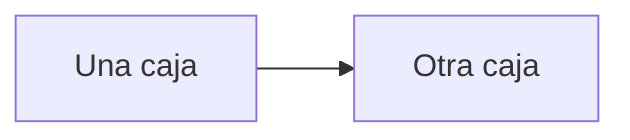

# Guía de publicación de la wiki

Esta página explica cómo funciona el sitio y qué hay que respetar para no
romperlo. No es parte del contenido del reto: es documentación del andamiaje.

## Cómo se publica

`.github/workflows/pages.yml` construye el sitio con Jekyll y lo despliega en
GitHub Pages cada vez que llega a `main` un cambio dentro de `docs/` o en el
propio workflow. También se puede disparar a mano con *Run workflow*.

{: .advertencia }
> El Source de GitHub Pages tiene que estar en **GitHub Actions**, no en *Deploy
> from a branch*. Si alguien lo cambia, el despliegue deja de funcionar aunque
> el workflow pase en verde.

La URL pública es `https://mati-mbit.github.io/arqsoft-reto-3/`.

## Front matter

Tres plugins hacen que el front matter sea opcional:
`jekyll-optional-front-matter` publica cualquier `.md` aunque no lo tenga,
`jekyll-titles-from-headings` toma el título del primer encabezado y
`jekyll-relative-links` convierte los enlaces entre archivos `.md` en enlaces
web válidos.

Aun así, las páginas del reto declaran su front matter, porque la navegación
depende de él:

| Campo | Para qué |
|---|---|
| `title` | El texto del menú lateral |
| `nav_order` | La posición en el menú |
| `helix_section` | La sección de Helix que esta página alimenta. No lo usa Jekyll: lo usa el contrato de réplica |
| `parent` | Anida la página bajo otra que tenga `has_children: true` |

## Enlaces entre páginas

Se escriben con la ruta relativa al archivo `.md`, no a la URL publicada:

```markdown
[escenarios de calidad](quality-attributes.md)
[las decisiones](modelos/adrs.md)
[el problema](../architecture.md)
```

## Imágenes y diagramas

| Qué | Dónde va |
|---|---|
| Fuentes de diagramas | `docs/modelos/drawio/*.drawio` |
| Diagramas exportados | `docs/modelos/png/nn-DG-XXX-nnn.png` |
| Gráficas de resultados | `docs/assets/resultados/graficas/` |
| Casos testigo anotados | `docs/assets/resultados/testigos/` |
| Clips | `docs/assets/resultados/clips/` |
| Evidencias de demostración | `docs/assets/resultados/evidencias/` |

El prefijo numérico de los PNG fija el orden de lectura y hace evidente cuál
falta.

`docs/_includes/head_custom.html` le agrega a cada imagen y a cada diagrama
Mermaid un botón **Ampliar**, con zoom y arrastre a pantalla completa. No hay
que hacer nada en la página para que aparezca.

## Diagramas Mermaid

Se escriben en un bloque de código con el lenguaje `mermaid` y el navegador los
dibuja. La versión está fijada en `_config.yml`.

````markdown

````

## Callouts

Cuatro, definidos en `_config.yml`. Se usan con la sintaxis de Just the Docs:

```markdown
{: .importante }
> El texto del aviso.
```

Disponibles: `nota` (azul), `importante` (amarillo), `advertencia` (rojo) y
`tip` (verde).

## Vista previa local

```bash
cd docs
bundle install
bundle exec jekyll serve --livereload
```

{: .nota }
> Requiere Ruby 3.0 o superior. El Ruby que trae macOS es 2.6 y no alcanza para
> Jekyll 4.4. Mientras no haya un Ruby 3.x instalado, la verificación real es el
> workflow de Actions: empuje a una rama, ábrale un pull request y revise que el
> build pase antes de mezclar.

## Lo que no hay que hacer

- **No renombrar una página ya publicada** sin avisar. La URL se rompe, y en el
  reto 2 eso dejó muerto un enlace que el grupo tenía compartido.
- **No editar un PNG a mano.** Se regenera desde el `.drawio`.
- **No subir resultados crudos completos.** `analisis/resultados/` versiona solo
  lo que `results.md` cita; el resto lo filtra `.gitignore`.
