# Vista de componentes — plataforma de integración y analítica de la holding XYZ

## Cómo leer esta página

Esta vista responde **qué piezas tiene la plataforma y cómo se comunican**. Abre
con la arquitectura general, que es el diagrama de componentes del equipo
(`drawio/Reto3-Arquitectura-General-v2.drawio`) en notación UML, y sigue con un
acercamiento por táctica que usa sus mismos nombres: el conector por fuente
(INT-01), el contrato canónico en el borde (INT-04), el cambio contenido en un
conector (MOD-03), los tópicos y la coreografía (MOD-04 e INT-09) y las estrategias
de interpretación con su versión activa (MOD-03 y MOD-09).

Dos componentes sostienen los escenarios y se abren hasta su caja blanca y su
secuencia interna: el conector empresa N, que integra a la compañía de turismo,
y el motor de interpretación. La caja blanca del conector va en dos diagramas, uno por
pregunta: cómo lee y traduce, y cómo valida y publica. Las decisiones que estos
diagramas dibujan están en el [registro de ADR](adrs.md), y el índice de las
cuatro vistas, en [diagramas](diagramas.md).

{: .nota }
> Los diagramas son **vigentes**: sus ADR están aceptados. La fuente de cada uno es su página en
> `drawio/Reto3-Vista-Componentes.drawio`; la imagen se exporta desde ahí.

**Abrir en draw.io:** [Reto3-Vista-Componentes.drawio](https://app.diagrams.net/#Uhttps%3A%2F%2Fmati-mbit.github.io%2Farqsoft-reto-3%2Fmodelos%2Fdrawio%2FReto3-Vista-Componentes.drawio), con las 13 páginas de la vista,
en el visor de app.diagrams.net. Cada diagrama tiene además su enlace directo
bajo la imagen. La fuente versionada está en [`drawio/Reto3-Vista-Componentes.drawio`](drawio/Reto3-Vista-Componentes.drawio);
un cambio se hace ahí y se reexporta el PNG.

## Leyenda

| Símbolo | Qué significa |
|---|---|
| Caja con el ícono de componente | Un componente UML. «external» es un sistema de otra empresa. El segundo estereotipo es el del diagrama general: «adaptador», «bus de mensajes», «cola», «almacén», «plug-in», «registro» |
| Carpeta | Un paquete del diagrama general: un grupo de componentes con una misma responsabilidad |
| Círculo y semicírculo | Interfaz provista (círculo) y requerida (semicírculo) |
| Caja con «event» | Un tópico del bus de eventos canónicos: quien publica no conoce a quien se suscribe. Fuera del general, el bus se dibuja así, como sus tópicos |
| Cuadrado sobre el borde | Un puerto de la caja blanca; la flecha «delegate» lleva lo que entra o sale hasta la parte que lo atiende |
| `rol : Tipo` | Una parte de la caja blanca: el rol que juega en la táctica y el tipo del dominio que lo cumple |
| Elipse punteada | El uso de una táctica dentro del componente; sus líneas punteadas, rotuladas, ligan cada rol a la parte o al puerto que lo juega |
| `«tactic» {id = …, variante = …}` | La táctica del catálogo del curso que esa pieza implementa |
| `{control = …}` | Cuánto controla la holding al socio: bajo control (sus empresas) o fuera de control (una compañía adquirida) |
| `{distancia = …}`, `{binding = …}`, `{contract = …, v = …}` | Qué distancia de integración cierra la táctica, en qué momento se liga lo que cambia y contra qué versión del contrato se valida |
| Nota con la esquina doblada | La decisión y su precio, o la medida del escenario |
| Insignia rellena con el ID de un ASR | El elemento es **artefacto** de ese ASR: ahí se aplica la táctica o se hace el cambio |
| Insignia de contorno punteado | El elemento **participa** en la respuesta de ese ASR sin modificarse |
| Tabla bajo cada diagrama | La trazabilidad de la página: por ASR, su atributo, qué es artefacto, qué participa, la táctica y la medida del [escenario de calidad](../quality-attributes.md) |

## DG-CMP-001 · Arquitectura general

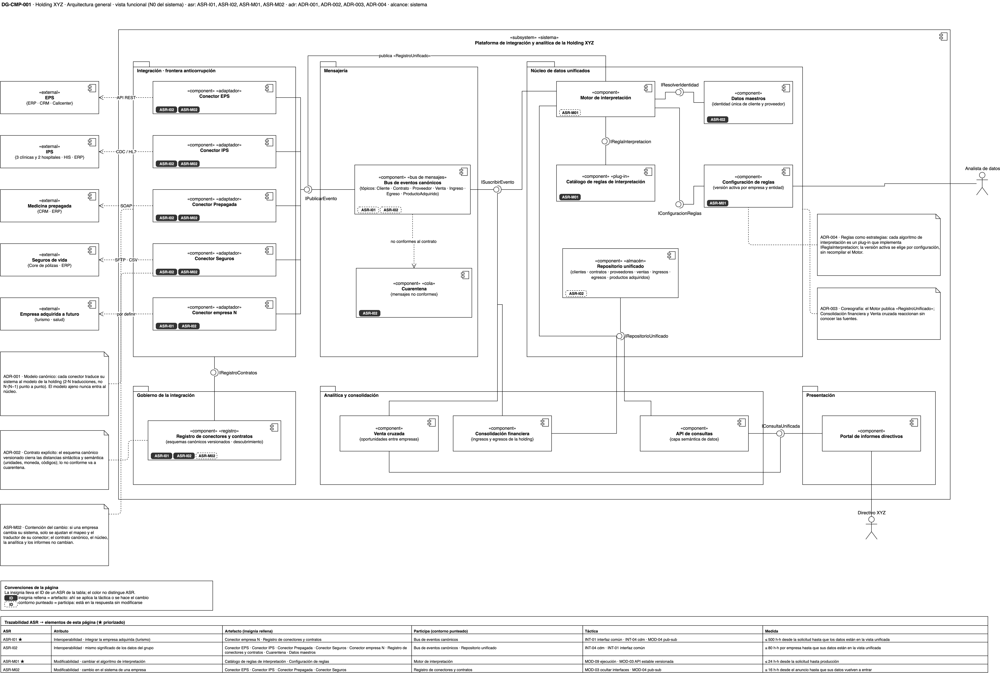

[Abrir DG-CMP-001 en draw.io](https://app.diagrams.net/?page-id=dg-cmp-001#Uhttps%3A%2F%2Fmati-mbit.github.io%2Farqsoft-reto-3%2Fmodelos%2Fdrawio%2FReto3-Vista-Componentes.drawio)

**Qué muestra.** El diagrama general del equipo, con su misma disposición. Seis
paquetes dentro de la plataforma. La integración tiene un conector por empresa:
EPS, IPS, Prepagada, Seguros y el conector empresa N para la compañía adquirida.
Cada conector lee su sistema y publica por `IPublicarEvento` en el bus de eventos
canónicos, que manda a la cuarentena lo que no cumple el contrato. El gobierno
de la integración guarda los contratos en el registro de conectores y contratos.
El núcleo tiene el motor de interpretación, que se suscribe al bus y usa los
datos maestros, el catálogo de reglas, la configuración de reglas y el
repositorio unificado, cada uno por su interfaz. La analítica y la presentación
consumen lo consolidado. El analista de datos cambia la configuración de reglas,
y el directivo consulta el portal.

**Decisiones que refleja.** Las cuatro, cada una en su nota:
[ADR-001](adrs.md) el modelo canónico detrás de cada conector, [ADR-002](adrs.md)
el contrato explícito con cuarentena, [ADR-003](adrs.md) la coreografía sobre el
bus y [ADR-004](adrs.md) las reglas como estrategias. La quinta nota es la
contención del cambio de ASR-M02.

**Qué no muestra.** Cómo funciona cada pieza por dentro; lo muestran los
acercamientos siguientes, uno por táctica.

**Excepción declarada.** Este diagrama no cumple el presupuesto visual de la
skill de diagramas, y es a propósito: reproduce entero el diagrama general del
equipo. Tiene 44 elementos donde la skill bloquea por encima de 20, cinco notas
largas donde admite tres de 160 caracteres, el bus dibujado como componente con
siete conexiones a `IPublicarEvento` y la troncal compartida de los conectores
del original. Los demás diagramas sí cumplen.

## Integrar la empresa N, una compañía de turismo (INT-01 · ASR-I01)

### DG-CMP-002 · Qué se agrega y qué no se toca

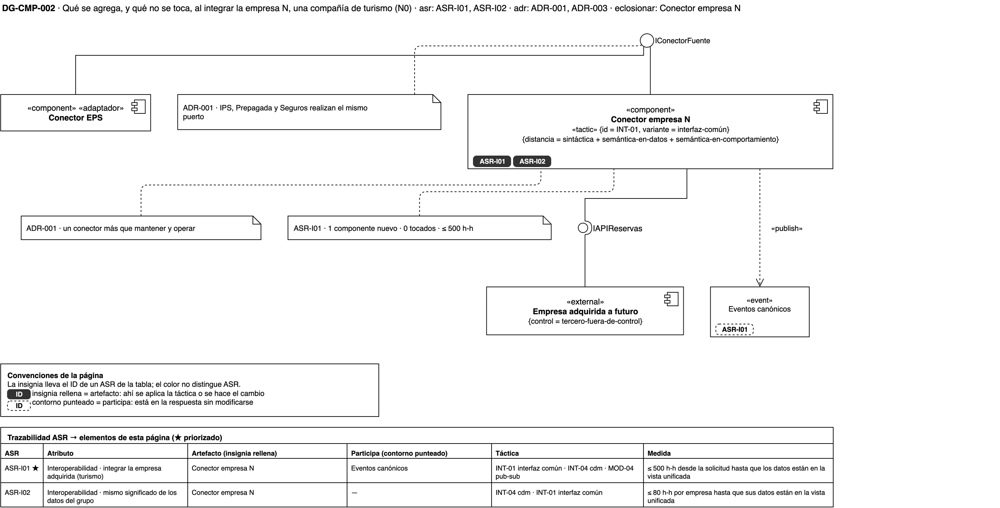

[Abrir DG-CMP-002 en draw.io](https://app.diagrams.net/?page-id=dg-cmp-002#Uhttps%3A%2F%2Fmati-mbit.github.io%2Farqsoft-reto-3%2Fmodelos%2Fdrawio%2FReto3-Vista-Componentes.drawio)

**Qué muestra.** El conector empresa N entra como un componente nuevo. Requiere
el API de reservas de la compañía de turismo, realiza el mismo puerto común que
los conectores de las empresas del grupo y publica en los eventos canónicos que
ya existen. Nada de lo
existente cambia de forma.

**Decisión que refleja.** [ADR-001](adrs.md), un conector por fuente tras un
puerto común (INT-01, variante interfaz común), que cierra las distancias
sintáctica, semántica en datos y semántica en comportamiento.

**Qué no muestra.** Cómo se traduce cada campo; lo muestra la caja blanca. De
los conectores existentes se dibuja uno; los otros tres realizan el mismo puerto.

### DG-CST-001 · El conector empresa N por dentro: leer y traducir

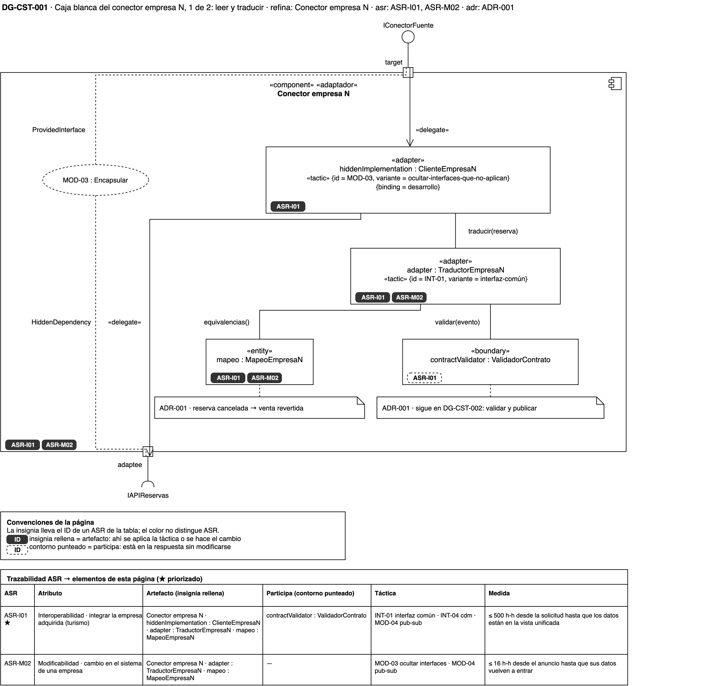

[Abrir DG-CST-001 en draw.io](https://app.diagrams.net/?page-id=dg-cst-001#Uhttps%3A%2F%2Fmati-mbit.github.io%2Farqsoft-reto-3%2Fmodelos%2Fdrawio%2FReto3-Vista-Componentes.drawio)

**Qué muestra.** El puerto `target` ofrece el puerto común; el puerto `adaptee`
es el único que conoce el API del socio. La parte que lo usa
(`hiddenImplementation`) lo esconde del resto, y el traductor (`adapter`) aplica
el mapeo de campos, moneda y estados antes de entregar el evento al validador.
Por ejemplo, una reserva cancelada se traduce como venta revertida.

**Decisión que refleja.** [ADR-001](adrs.md): el API del socio queda dentro del
conector (MOD-03, variante ocultar interfaces que no aplican), y el traductor
cierra las distancias (INT-01).

**Qué no muestra.** Qué hace el validador; sigue en DG-CST-002.

### DG-SEQ-001 · El primer lote de la empresa N

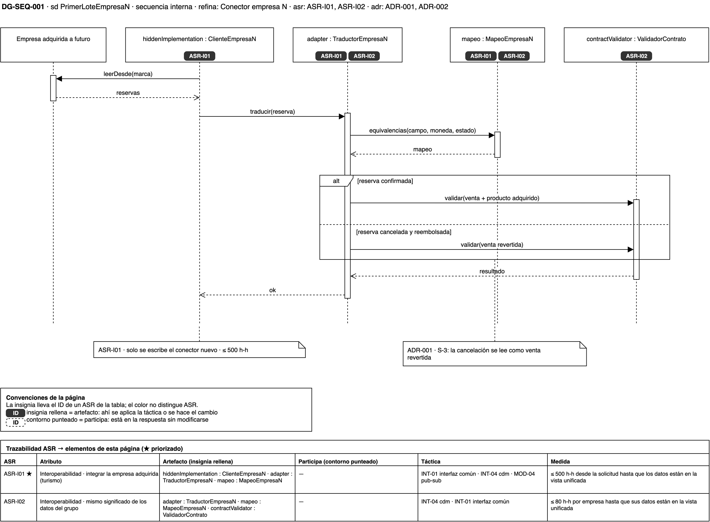

[Abrir DG-SEQ-001 en draw.io](https://app.diagrams.net/?page-id=dg-seq-001#Uhttps%3A%2F%2Fmati-mbit.github.io%2Farqsoft-reto-3%2Fmodelos%2Fdrawio%2FReto3-Vista-Componentes.drawio)

**Qué muestra.** El recorrido de una reserva por las partes del conector hasta
el validador. Una reserva confirmada se entrega como venta y producto adquirido;
una cancelada y reembolsada, como venta revertida.

**Decisión que refleja.** [ADR-001](adrs.md): la distancia semántica en
comportamiento se cierra en el mapeo del conector (S-3), y lo único que se
escribe para integrar turismo es este conector (≤ 500 h-h).

**Qué no muestra.** Si el evento cumple el contrato; lo muestra DG-SEQ-002.

## El contrato canónico en el borde (INT-04 · ASR-I02)

### DG-CMP-003 · Dónde se valida y qué pasa con lo que no cumple

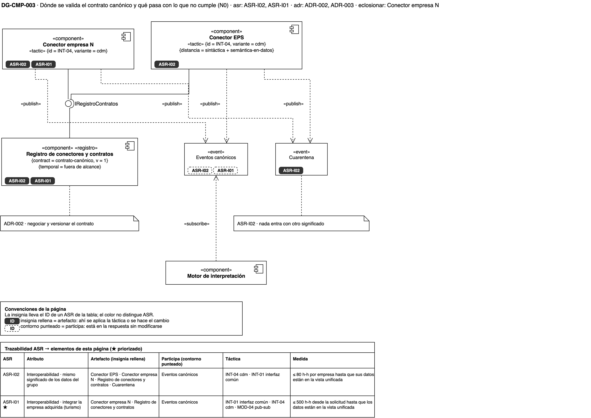

[Abrir DG-CMP-003 en draw.io](https://app.diagrams.net/?page-id=dg-cmp-003#Uhttps%3A%2F%2Fmati-mbit.github.io%2Farqsoft-reto-3%2Fmodelos%2Fdrawio%2FReto3-Vista-Componentes.drawio)

**Qué muestra.** Cada conector valida lo que traduce contra la versión vigente
del contrato, que guarda el registro de conectores y contratos. Lo que cumple va
a los eventos canónicos, a los que se suscribe el motor; lo que no, a la cuarentena con su
causa.

**Decisión que refleja.** [ADR-002](adrs.md): el modelo canónico declarado en un
contrato versionado (INT-04, variante modelo canónico), validado en el borde de
cada empresa. El precio es negociar y versionar el contrato.

**Qué no muestra.** Cómo valida el conector por dentro; lo muestra DG-CST-002.

### DG-CST-002 · El conector empresa N por dentro: validar y publicar

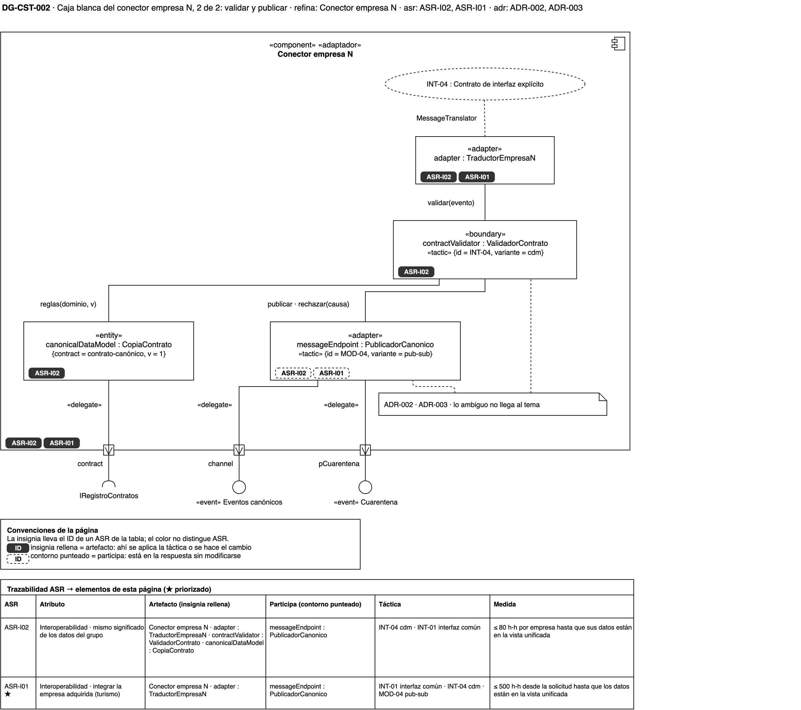

[Abrir DG-CST-002 en draw.io](https://app.diagrams.net/?page-id=dg-cst-002#Uhttps%3A%2F%2Fmati-mbit.github.io%2Farqsoft-reto-3%2Fmodelos%2Fdrawio%2FReto3-Vista-Componentes.drawio)

**Qué muestra.** El traductor entrega el evento al validador
(`contractValidator`), que lo compara con la copia del contrato
(`canonicalDataModel`) que el conector trae del registro por el puerto
`contract`. El punto de publicación (`messageEndpoint`) lleva lo que cumple al
puerto `channel` y lo rechazado al puerto de la cuarentena. Si el registro de
contratos no responde, el validador sigue con la copia (SUP-03).

**Decisión que refleja.** [ADR-002](adrs.md) (INT-04, modelo canónico) y
[ADR-003](adrs.md) (MOD-04, publicar-suscribir). El traductor juega además el
rol `MessageTranslator` del modelo canónico: hay uno por fuente.

**Qué no muestra.** Cómo se lee el sistema del socio; lo muestra DG-CST-001.

**Ficha de eclosión del conector empresa N** (las dos cajas blancas).

| Parte | Rol | Estado que guarda | Táctica |
|---|---|---|---|
| `hiddenImplementation : ClienteEmpresaN` | Lee el sistema de reservas y esconde su API | Marca de la última lectura | MOD-03 |
| `adapter : TraductorEmpresaN` | Traduce cada reserva al modelo canónico | Ninguno | INT-01; `MessageTranslator` de INT-04 |
| `mapeo : MapeoEmpresaN` | Equivalencias de campos, códigos, moneda y estados | La tabla de equivalencias | — |
| `contractValidator : ValidadorContrato` | Valida el evento contra el contrato; viaja en el kit común de los conectores | Ninguno | INT-04 |
| `canonicalDataModel : CopiaContrato` | Copia de la versión vigente del contrato | La versión en caché | — |
| `messageEndpoint : PublicadorCanonico` | Publica en los eventos canónicos o en la cuarentena | Ninguno | MOD-04 |

| Puerto | Interfaz | Rol |
|---|---|---|
| `target` | provee `IConectorFuente` | `ProvidedInterface` de MOD-03 y `Target` de INT-01 |
| `adaptee` | requiere `IAPIReservas` | `HiddenDependency` de MOD-03 y `Adaptee` de INT-01 |
| `contract` | requiere `IRegistroContratos` | `Contract` de INT-04 |
| `channel` | publica `Eventos canónicos` | `Channel` de MOD-04 |
| `pCuarentena` | publica en la `Cuarentena` | — |

| Distancia | Cómo la cierra el contrato |
|---|---|
| Sintáctica | El tipo de cada campo está en el contrato |
| Semántica en datos | La unidad, la moneda y los códigos válidos están en el contrato |
| Semántica en comportamiento | La cierra el mapeo del conector (INT-01), no el contrato |
| Temporal | Fuera de alcance: no se conoce hasta la debida diligencia |
| De recursos | No aplica en este reto |

### DG-SEQ-002 · Validar un registro

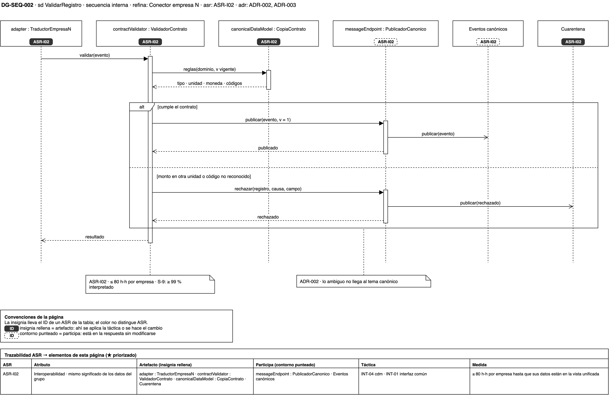

[Abrir DG-SEQ-002 en draw.io](https://app.diagrams.net/?page-id=dg-seq-002#Uhttps%3A%2F%2Fmati-mbit.github.io%2Farqsoft-reto-3%2Fmodelos%2Fdrawio%2FReto3-Vista-Componentes.drawio)

**Qué muestra.** El validador pide a la copia del contrato el tipo, la unidad, la
moneda y los códigos del dominio. Si el evento cumple, se publica con la versión
del contrato; si trae un monto en otra unidad o un código que el contrato no
reconoce, se rechaza con su causa y su campo, y va a la cuarentena.

**Decisión que refleja.** [ADR-002](adrs.md): ningún registro llega a los
eventos canónicos con un significado distinto del que le dio su empresa. La medida es
≤ 80 h-h por empresa, con ≥ 99 % interpretado (S-9).

**Qué no muestra.** Quién revisa la cuarentena; es una pregunta abierta del
[registro de ADR](adrs.md).

## Absorber el cambio de una IPS (MOD-03 · ASR-M02)

### DG-CMP-004 · Hasta dónde llega el cambio

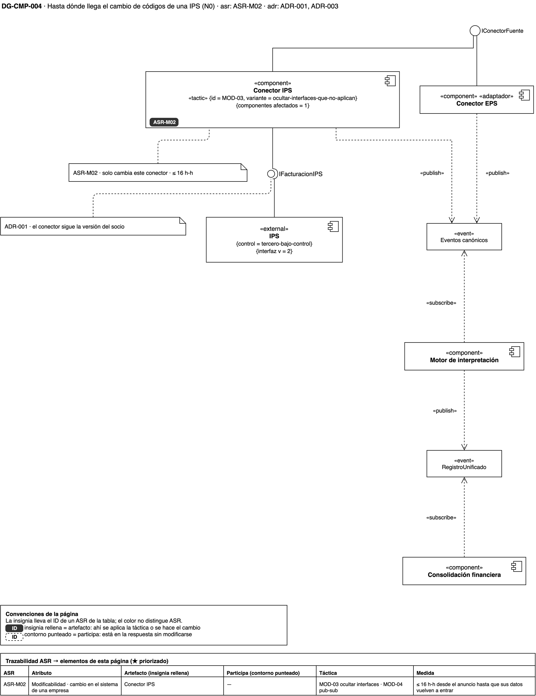

[Abrir DG-CMP-004 en draw.io](https://app.diagrams.net/?page-id=dg-cmp-004#Uhttps%3A%2F%2Fmati-mbit.github.io%2Farqsoft-reto-3%2Fmodelos%2Fdrawio%2FReto3-Vista-Componentes.drawio)

**Qué muestra.** La IPS publica la versión 2 de su interfaz con códigos nuevos.
El único componente que la conoce es su conector; el conector de la EPS, el motor
y la consolidación siguen hablando en términos canónicos. El cambio afecta un
solo componente.

**Decisión que refleja.** [ADR-001](adrs.md): la interfaz del socio queda
escondida dentro de su conector (MOD-03).

**Qué no muestra.** El interior del conector de la IPS. Tiene la misma
estructura que el conector empresa N (DG-CST-001 y DG-CST-002), y por eso no se abre
otra vez.

### DG-SEQ-003 · La IPS cambia sus códigos

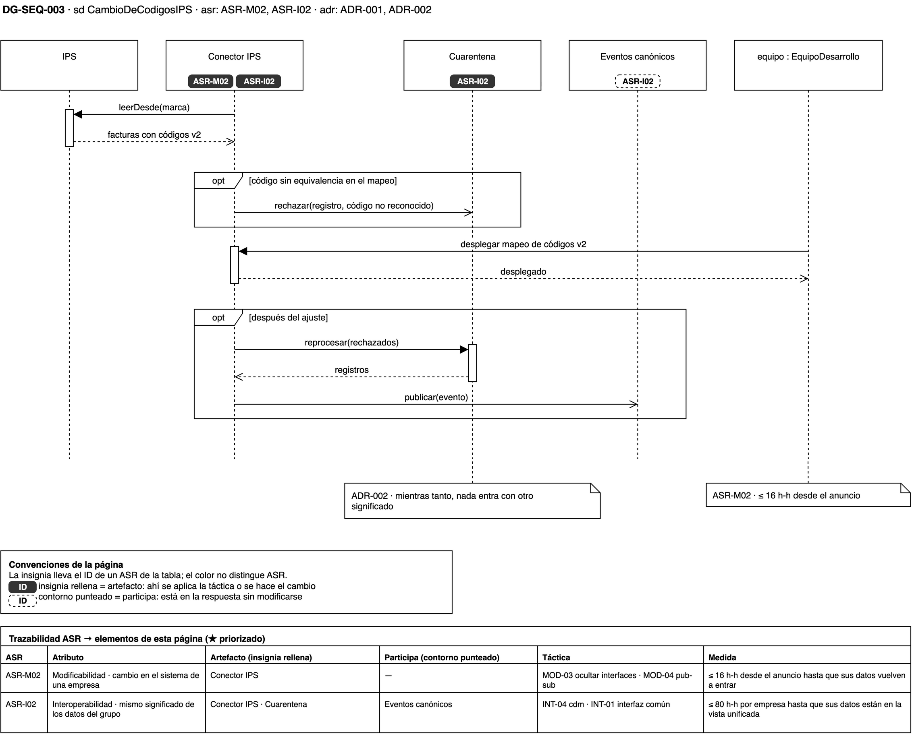

[Abrir DG-SEQ-003 en draw.io](https://app.diagrams.net/?page-id=dg-seq-003#Uhttps%3A%2F%2Fmati-mbit.github.io%2Farqsoft-reto-3%2Fmodelos%2Fdrawio%2FReto3-Vista-Componentes.drawio)

**Qué muestra.** Antes del ajuste, los registros con códigos sin equivalencia van
a la cuarentena. El equipo despliega el mapeo nuevo en el conector de la IPS, y
los rechazados se reprocesan y se publican.

**Decisión que refleja.** [ADR-001](adrs.md) y [ADR-002](adrs.md): el cambio se
contiene en el conector, y mientras tanto nada entra con otro significado. La
medida es ≤ 16 h-h desde el anuncio.

**Qué no muestra.** Cómo se entera la holding de un cambio que la empresa no
anunció; eso es disponibilidad y queda fuera de este reto.

## Tópicos y coreografía (MOD-04, INT-09 · ASR-I01, ASR-M02)

### DG-CMP-005 · Quién publica y quién reacciona

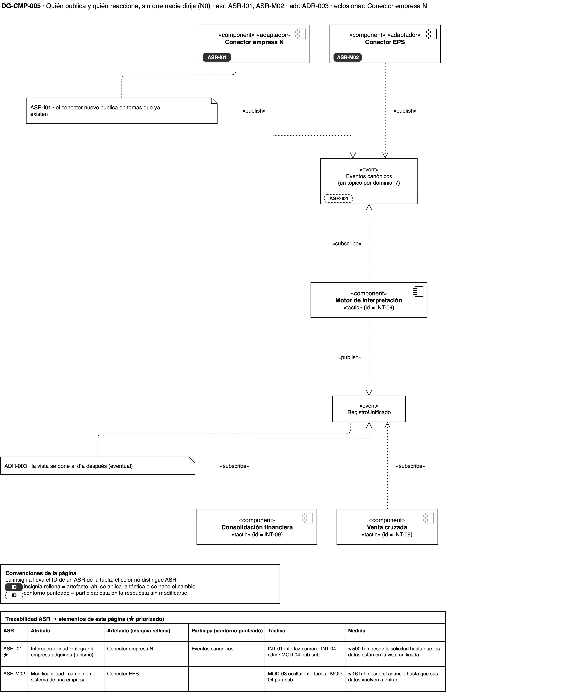

[Abrir DG-CMP-005 en draw.io](https://app.diagrams.net/?page-id=dg-cmp-005#Uhttps%3A%2F%2Fmati-mbit.github.io%2Farqsoft-reto-3%2Fmodelos%2Fdrawio%2FReto3-Vista-Componentes.drawio)

**Qué muestra.** Los conectores publican en los eventos canónicos sin saber quién
los lee. El motor se suscribe, interpreta y publica el `RegistroUnificado`, al que
reaccionan la consolidación financiera y la venta cruzada, cada una por su
cuenta. Nadie dirige el flujo.

**Decisión que refleja.** [ADR-003](adrs.md): el bus, con un tópico por dominio, hace de intermediario
(MOD-04, publicar-suscribir), y los consumidores reaccionan a eventos en lugar de
ser llamados (INT-09). Un conector nuevo publica en tópicos que ya existen.

**Precio que se ve.** La vista unificada se pone al día después de que la fuente
publica (consistencia eventual), y el flujo completo no vive en un solo lugar.

**Qué no muestra.** El ciclo de un evento en su suscripción; lo muestra
[DG-STM-002](vista-informacion.md).

## Cambiar un algoritmo de interpretación (MOD-03, MOD-09 · ASR-M01)

### DG-CMP-006 · El motor y sus estrategias

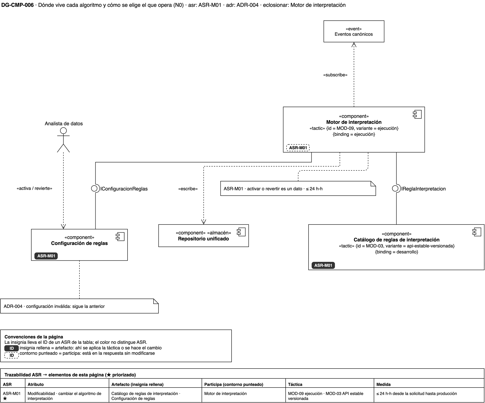

[Abrir DG-CMP-006 en draw.io](https://app.diagrams.net/?page-id=dg-cmp-006#Uhttps%3A%2F%2Fmati-mbit.github.io%2Farqsoft-reto-3%2Fmodelos%2Fdrawio%2FReto3-Vista-Componentes.drawio)

**Qué muestra.** El motor requiere la interfaz `IReglaInterpretacion`, que
realizan las versiones del catálogo de reglas, y lee de la configuración de
reglas cuál opera para cada empresa. El analista de datos activa o revierte
cambiando ese dato, y la configuración guarda quién y cuándo.

**Decisión que refleja.** [ADR-004](adrs.md): la interfaz estable y versionada
separa al motor de cada algoritmo (MOD-03, variante API estable versionada), y
la versión activa se liga en ejecución (MOD-09, variante ejecución).

**Qué no muestra.** Cómo el motor recarga la versión sin reiniciarse; lo muestra
la caja blanca.

### DG-CST-003 · El motor por dentro

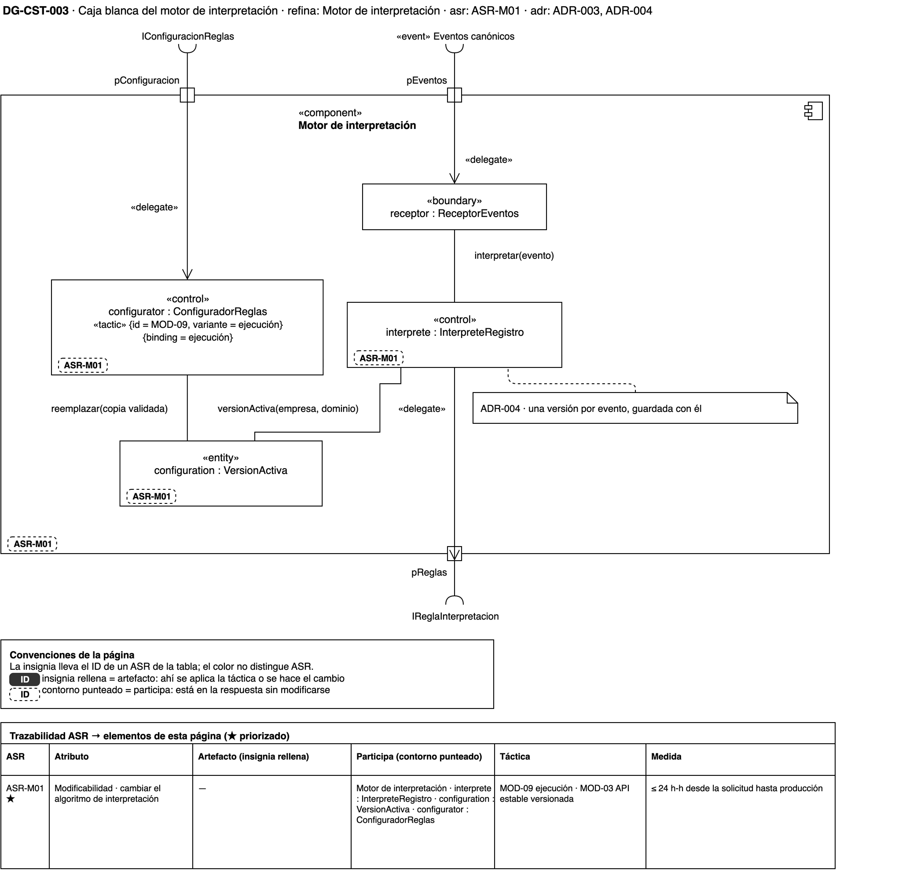

[Abrir DG-CST-003 en draw.io](https://app.diagrams.net/?page-id=dg-cst-003#Uhttps%3A%2F%2Fmati-mbit.github.io%2Farqsoft-reto-3%2Fmodelos%2Fdrawio%2FReto3-Vista-Componentes.drawio)

**Qué muestra.** El configurador lee la configuración de reglas, valida la
activación nueva y reemplaza una copia en memoria de la versión activa. El
intérprete consulta esa copia una vez por evento y llama a la regla por el
puerto de reglas.

**Decisión que refleja.** [ADR-004](adrs.md): el configurador es la parte que
implementa MOD-09; cambiar de versión no reinicia ni redespliega el motor.

**Qué no muestra.** La escritura en la vista unificada.

**Ficha de eclosión.**

| Parte | Rol | Estado que guarda | Táctica |
|---|---|---|---|
| `receptor : ReceptorEventos` | Recibe los eventos canónicos | Ninguno | — |
| `interprete : InterpreteRegistro` | Toma la versión activa y aplica la regla | Ninguno | — |
| `configuration : VersionActiva` | Copia en memoria de la versión activa por empresa y dominio | La activación vigente | — |
| `configurator : ConfiguradorReglas` | Lee, valida y recarga la configuración | Ninguno | MOD-09 |

### DG-SEQ-004 · Activar y revertir el algoritmo

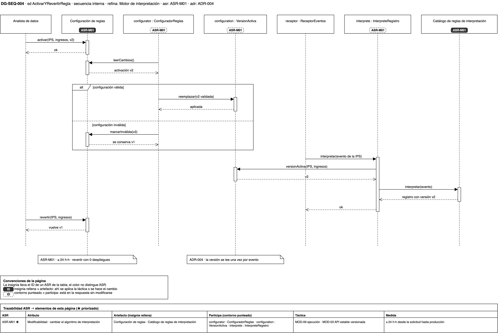

[Abrir DG-SEQ-004 en draw.io](https://app.diagrams.net/?page-id=dg-seq-004#Uhttps%3A%2F%2Fmati-mbit.github.io%2Farqsoft-reto-3%2Fmodelos%2Fdrawio%2FReto3-Vista-Componentes.drawio)

**Qué muestra.** El analista de datos activa la versión 2 para los ingresos
de una IPS. Si la configuración es válida, el configurador la aplica; si no, se
conserva la versión 1. Un evento de esa IPS se interpreta con la versión 2, y al
revertir vuelve la 1, sin un despliegue de por medio.

**Decisión que refleja.** [ADR-004](adrs.md): activar y revertir son cambios de
un dato, y la medida de ASR-M01 (≤ 24 h-h) se gasta en escribir y probar la
versión nueva, no en desplegar.

**Qué no muestra.** Cómo se publica la versión 2 en el catálogo; lo muestra
[DG-DEP-003](vista-despliegue.md).

## Tácticas de esta vista

| Táctica | ADR | Dónde se ve |
|---|---|---|
| INT-01 Wrapper (adaptador) · interfaz común | ADR-001 | Conector empresa N (DG-CMP-002) y su traductor (DG-CST-001) |
| MOD-03 Encapsular · ocultar interfaces que no aplican | ADR-001 | Parte que esconde el API del socio (DG-CST-001); conector de la IPS (DG-CMP-004) |
| INT-04 Contrato de interfaz explícito · modelo canónico | ADR-002 | Conectores (DG-CMP-003) y su validador (DG-CST-002) |
| MOD-04 Usar intermediarios · publicar-suscribir | ADR-003 | Bus de eventos canónicos (DG-CMP-001), sus tópicos (DG-CMP-005) y el punto de publicación del conector (DG-CST-002) |
| INT-09 Coreografía | ADR-003 | Nota de coreografía (DG-CMP-001); motor, consolidación y venta cruzada (DG-CMP-005) |
| MOD-03 Encapsular · API estable versionada | ADR-004 | Catálogo de reglas tras `IReglaInterpretacion` (DG-CMP-006) |
| MOD-09 Ligado en configuración · ejecución | ADR-004 | Motor (DG-CMP-006) y su configurador (DG-CST-003) |
