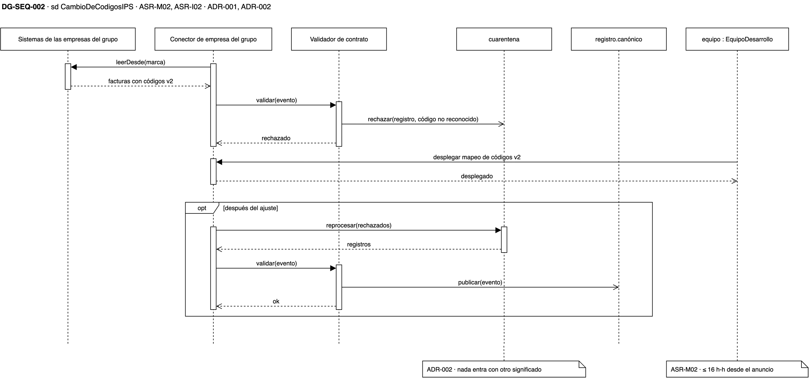
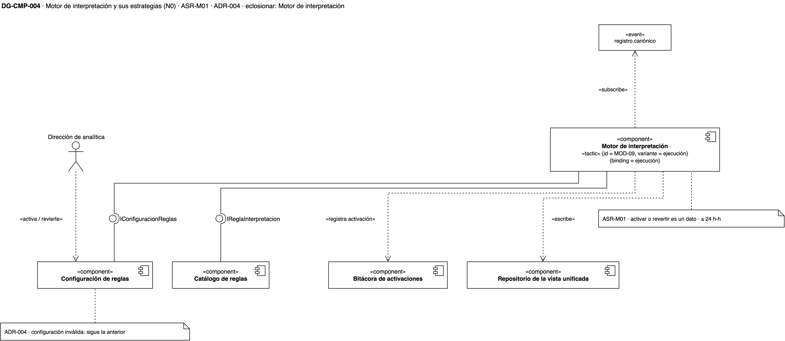
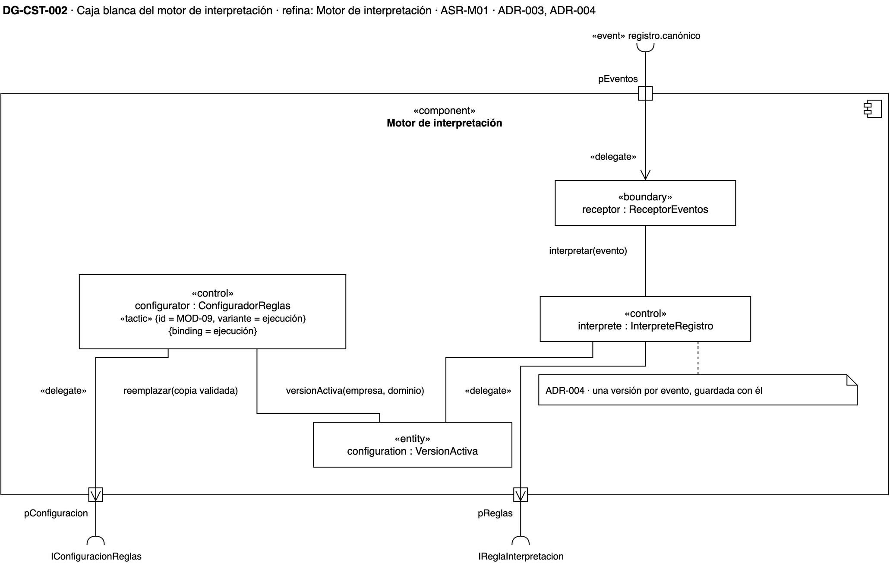

# Vista de componentes — plataforma de integración y analítica de la holding XYZ

## Cómo leer esta página

Esta vista responde **qué piezas tiene la plataforma y cómo se comunican**. Abre
con el panorama del sistema y sigue con tres acercamientos, uno por grupo de
escenarios: integrar la compañía de turismo (ASR-I01 y ASR-I02), absorber el
cambio de una IPS en su sistema (ASR-M02) y cambiar un algoritmo de
interpretación (ASR-M01).

Los dos componentes que sostienen esos escenarios, el conector y el motor de
interpretación, se abren dos veces: primero su caja blanca, con las partes que
lo forman, y después la secuencia que las recorre. Las decisiones que estos
diagramas dibujan están en el [registro de ADR](adrs.md), y el índice de las
cuatro vistas, en [diagramas](diagramas.md).

{: .nota }
> Los diagramas son **vigentes**: sus ADR están aceptados. La fuente de cada uno es su página en
> `drawio/Reto3-Vista-Componentes.drawio`; la imagen se exporta desde ahí.

## Leyenda

| Símbolo | Qué significa |
|---|---|
| Caja con el ícono de componente | Un componente UML. «external» es un sistema de otra empresa; «subsystem», un grupo de componentes; «COTS», un producto que se compra y no se construye |
| Círculo y semicírculo | Interfaz provista (círculo) y requerida (semicírculo) |
| Caja con «event» | Un tema del bus: quien publica no conoce a quien se suscribe |
| Cuadrado sobre el borde | Un puerto de la caja blanca; la flecha «delegate» lleva lo que entra o sale hasta la parte que lo atiende |
| `rol : Tipo` | Una parte de la caja blanca: el rol que juega en la táctica y el tipo del dominio que lo cumple |
| Elipse punteada | El uso de una táctica dentro del componente; sus líneas punteadas, rotuladas, ligan cada rol a la parte que lo juega |
| `«tactic» {id = …, variante = …}` | La táctica del [catálogo del curso](adrs.md) que esa pieza implementa |
| `{control = …}` | Cuánto controla la holding al socio: bajo control (sus empresas) o fuera de control (una compañía adquirida) |
| `{distancia = …}`, `{binding = …}` | Qué distancia de integración cierra la táctica, y en qué momento se liga lo que cambia |
| Nota con la esquina doblada | La decisión y su precio, o la medida del escenario |

## DG-CMP-001 · Panorama de la plataforma

**Qué muestra.** Los tres subsistemas de la plataforma y lo que los une. La
integración lee los sistemas de las empresas y de la compañía de turismo, valida
contra el registro de contratos y publica en dos temas: el registro canónico y
la cuarentena. El núcleo se suscribe al primero, escribe en la vista unificada y
publica el registro consolidado, al que reacciona la analítica.

**Decisión que refleja.** [ADR-003](adrs.md): el bus con un tema por dominio
desacopla a quien publica de quien consume (MOD-04), y los consumidores
reaccionan al registro consolidado sin que nadie los llame (INT-09).

**Qué no muestra.** Los componentes dentro de cada subsistema; los abren los
diagramas siguientes.

## Integrar la compañía de turismo (ASR-I01, ASR-I02)

### DG-CMP-002 · Qué se agrega y qué no se toca

**Qué muestra.** El conector de turismo entra como un componente nuevo. Requiere
el API de reservas del socio, realiza el mismo puerto común que los ocho
conectores existentes y usa el mismo validador de contrato. Nada de lo existente
cambia de forma.

**Decisión que refleja.** [ADR-001](adrs.md), un conector por fuente tras un
puerto común (INT-01, variante interfaz común), y [ADR-002](adrs.md), el contrato
canónico que el validador aplica (INT-04, modelo canónico).

**Qué no muestra.** Cómo se traduce cada campo; lo muestra la caja blanca.

### DG-CST-001 · El conector de turismo por dentro

**Qué muestra.** El puerto `target` ofrece el puerto común; el puerto `adaptee`
es el único que conoce el API del socio. La parte que lo usa
(`hiddenImplementation`) lo esconde del resto, y el traductor (`adapter`) aplica
el mapeo de campos, moneda y estados. Por ejemplo, una reserva cancelada se
traduce como venta revertida.

**Decisión que refleja.** [ADR-001](adrs.md): el API del socio queda dentro del
conector (MOD-03, variante ocultar interfaces que no aplican), y el traductor
cierra las distancias sintáctica, semántica en datos y semántica en
comportamiento (INT-01).

**Qué no muestra.** El validador, que es del kit común y no del conector.

**Ficha de eclosión.**

| Parte | Rol | Estado que guarda | Táctica |
|---|---|---|---|
| `hiddenImplementation : ClienteReservas` | Lee el sistema de reservas y esconde su API | Marca de la última lectura | MOD-03 |
| `adapter : TraductorTurismo` | Traduce cada reserva al modelo canónico | Ninguno | INT-01 |
| `mapeo : MapeoTurismo` | Equivalencias de campos, códigos, moneda y estados | La tabla de equivalencias | — |

### DG-SEQ-001 · El primer lote de turismo

**Qué muestra.** El recorrido de una reserva por las partes del conector hasta
el validador. Si cumple el contrato, se publica en el tema canónico; si no se
puede interpretar, va a la cuarentena con su causa.

**Decisión que refleja.** [ADR-002](adrs.md): ningún registro entra a la vista
unificada con un significado distinto del que le dio la compañía.

**Qué no muestra.** Lo que hace el motor con el registro publicado.

## Absorber el cambio de una IPS (ASR-M02)

### DG-CMP-003 · Hasta dónde llega el cambio

**Qué muestra.** La IPS publica la versión 2 de su interfaz con códigos nuevos.
El único componente que la conoce es su conector, y el validador, el motor y la
consolidación siguen hablando en términos canónicos. El cambio afecta un solo
componente.

**Decisión que refleja.** [ADR-001](adrs.md): la interfaz del socio queda
escondida dentro de su conector (MOD-03).

**Qué no muestra.** El interior del conector de empresa. Tiene la misma
estructura que el de turismo (DG-CST-001), y por eso no se abre otra vez.

### DG-SEQ-002 · La IPS cambia sus códigos

**Qué muestra.** Antes del ajuste, los registros con códigos que el contrato no
reconoce van a la cuarentena. El equipo despliega el mapeo nuevo en el conector
de la IPS, y los rechazados se reprocesan y se publican.

**Decisión que refleja.** [ADR-001](adrs.md) y [ADR-002](adrs.md): el cambio se
contiene en el conector, y mientras tanto nada entra con otro significado.

**Qué no muestra.** Cómo se entera la holding de un cambio que la empresa no
anunció; eso es disponibilidad y queda fuera de este reto.

## Cambiar un algoritmo de interpretación (ASR-M01)

### DG-CMP-004 · El motor y sus estrategias

**Qué muestra.** El motor requiere la interfaz `IReglaInterpretacion`, que
realizan las versiones del catálogo de reglas, y lee de la configuración de
reglas cuál opera para cada empresa. La dirección de analítica activa o revierte
cambiando ese dato, y cada cambio queda en la bitácora.

**Decisión que refleja.** [ADR-004](adrs.md): la interfaz estable y versionada
separa al motor de cada algoritmo (MOD-03, variante API estable versionada), y
la versión activa se liga en ejecución (MOD-09, variante ejecución).

**Qué no muestra.** Cómo el motor recarga la versión sin reiniciarse; lo muestra
la caja blanca.

### DG-CST-002 · El motor por dentro

**Qué muestra.** El configurador lee la configuración de reglas, valida la
activación nueva y reemplaza una copia en memoria de la versión activa. El
intérprete consulta esa copia una vez por evento y llama a la regla por el
puerto de reglas.

**Decisión que refleja.** [ADR-004](adrs.md): el configurador es la parte que
implementa MOD-09; cambiar de versión no reinicia ni redespliega el motor.

**Qué no muestra.** La escritura en la vista unificada.

**Ficha de eclosión.**

| Parte | Rol | Estado que guarda | Táctica |
|---|---|---|---|
| `receptor : ReceptorEventos` | Recibe los eventos del tema canónico | Ninguno | — |
| `interprete : InterpreteRegistro` | Toma la versión activa y aplica la regla | Ninguno | — |
| `configuration : VersionActiva` | Copia en memoria de la versión activa por empresa y dominio | La activación vigente | — |
| `configurator : ConfiguradorReglas` | Lee, valida y recarga la configuración | Ninguno | MOD-09 |

### DG-SEQ-003 · Activar y revertir el algoritmo

**Qué muestra.** La dirección de analítica activa la versión 2 para los ingresos
de una IPS. Si la configuración es válida, el configurador la aplica; si no, se
conserva la versión 1. Un evento de esa IPS se interpreta con la versión 2, y al
revertir vuelve la 1, sin un despliegue de por medio.

**Decisión que refleja.** [ADR-004](adrs.md): activar y revertir son cambios de
un dato, y la medida de ASR-M01 (≤ 24 h-h) se gasta en escribir y probar la
versión nueva, no en desplegar.

**Qué no muestra.** Cómo se publica la versión 2 en el catálogo; lo muestra
[DG-DEP-002](vista-despliegue.md).

## Tácticas de esta vista

| Táctica | ADR | Dónde se ve |
|---|---|---|
| INT-01 Wrapper (adaptador) · interfaz común | ADR-001 | Conector de turismo (DG-CMP-002) y su traductor (DG-CST-001) |
| MOD-03 Encapsular · ocultar interfaces que no aplican | ADR-001 | Parte que esconde el API del socio (DG-CST-001); conector de empresa (DG-CMP-003) |
| INT-04 Contrato de interfaz explícito · modelo canónico | ADR-002 | Validador de contrato (DG-CMP-002) |
| MOD-04 Usar intermediarios · publicar-suscribir | ADR-003 | Tema canónico (DG-CMP-001) |
| INT-09 Coreografía | ADR-003 | Núcleo de interpretación (DG-CMP-001) |
| MOD-03 Encapsular · API estable versionada | ADR-004 | `IReglaInterpretacion` (DG-CMP-004) |
| MOD-09 Ligado en configuración · ejecución | ADR-004 | Motor (DG-CMP-004) y su configurador (DG-CST-002) |
