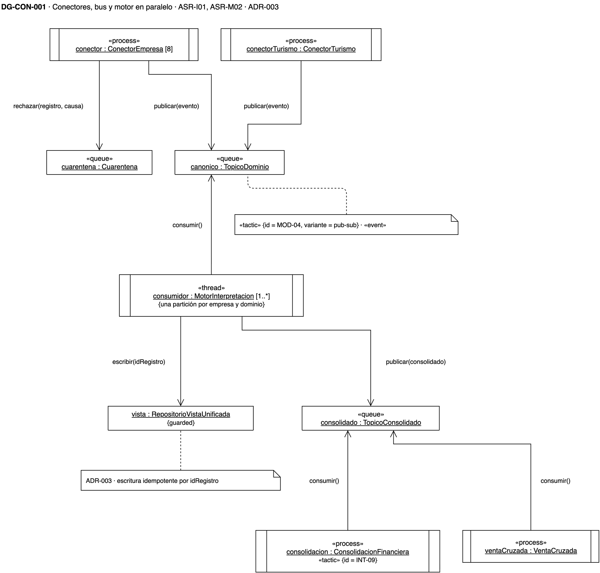
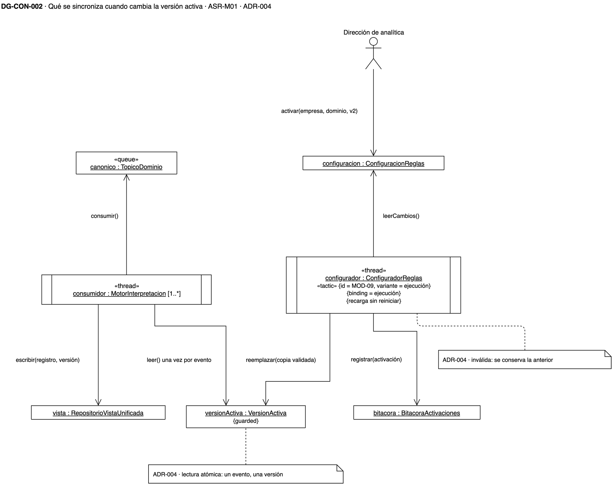

# Vista de concurrencia — plataforma de integración y analítica de la holding XYZ

## Cómo leer esta página

Esta vista responde **qué corre en paralelo y qué se sincroniza**. El primer
diagrama muestra los procesos de toda la plataforma; el segundo se acerca al
momento en que cambia la versión activa de una regla mientras el motor procesa
eventos.

Las decisiones que estos diagramas dibujan están en el
[registro de ADR](adrs.md), y el índice de las cuatro vistas, en
[diagramas](diagramas.md).

{: .nota }
> Los diagramas son **vigentes**: sus ADR están aceptados. La fuente es `drawio/Reto3-Vista-Concurrencia.drawio`.

## Leyenda

| Símbolo | Qué significa |
|---|---|
| Caja con doble barra lateral | Un objeto activo: un proceso («process») o un hilo («thread») con su propio flujo de control |
| `[8]`, `[1..*]` | Cuántas instancias corren a la vez |
| Caja con «queue» | Un tema o una cola del bus |
| Nombre subrayado | Una instancia, en la forma `nombre : Tipo` |
| `{guarded}` | Un recurso compartido cuyo acceso se protege |
| Flecha con rótulo | El mensaje que un objeto le envía a otro; en `consumir()`, la flecha va hacia la cola de la que se lee |
| `«tactic» {id = …, variante = …}` | La táctica del catálogo del curso que ese objeto implementa |

## DG-CON-001 · Lo que corre en paralelo

**Qué muestra.** Ocho procesos de conector, uno por empresa, más el de turismo,
publican en el tema canónico sin coordinarse entre sí. El motor lo consume con
uno o más hilos, cada uno sobre una partición por empresa y dominio, y publica el
registro consolidado. La consolidación financiera y la venta cruzada lo consumen
cada una por su cuenta.

**Qué se sincroniza.** La escritura en la vista unificada es idempotente por
identificador de registro: un evento entregado dos veces no duplica el registro.
El orden solo se garantiza dentro de una empresa y un dominio.

**Decisión que refleja.** [ADR-003](adrs.md): el bus publicar-suscribir (MOD-04)
y la coreografía entre consumidores (INT-09).

**Qué no muestra.** Cuánto tarda un registro en llegar; eso es desempeño y queda
fuera de este reto.

## DG-CON-002 · Cambio de versión a mitad de un lote

**Qué muestra.** Dos flujos que comparten un solo recurso, la versión activa en
memoria. El configurador, en su propio hilo, lee la configuración, valida la
activación nueva, reemplaza la copia y registra el cambio en la bitácora. Los
hilos del motor leen esa copia mientras consumen eventos.

**Qué se sincroniza.** La versión activa se lee una sola vez por evento, y la
copia se reemplaza entera. Así, un registro se interpreta con una sola versión
aunque la activación cambie a mitad de un lote, y la versión queda guardada con
el registro.

**Decisión que refleja.** [ADR-004](adrs.md): el ligado en ejecución (MOD-09,
variante ejecución) con recarga sin reiniciar. Si la configuración nueva no es
válida, se conserva la anterior.

**Qué no muestra.** Qué pasa si el configurador falla; es disponibilidad y queda
fuera de este reto.
