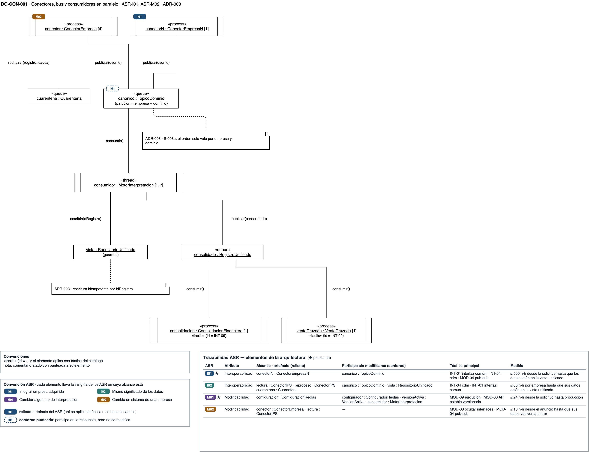
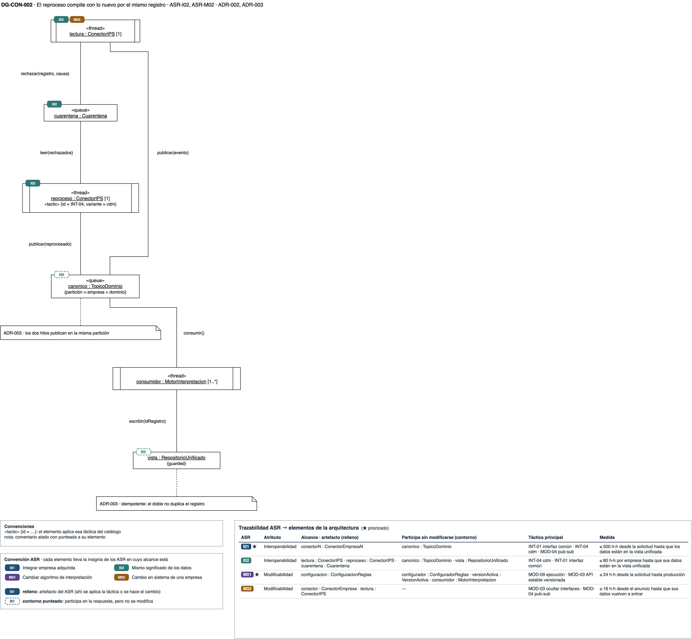
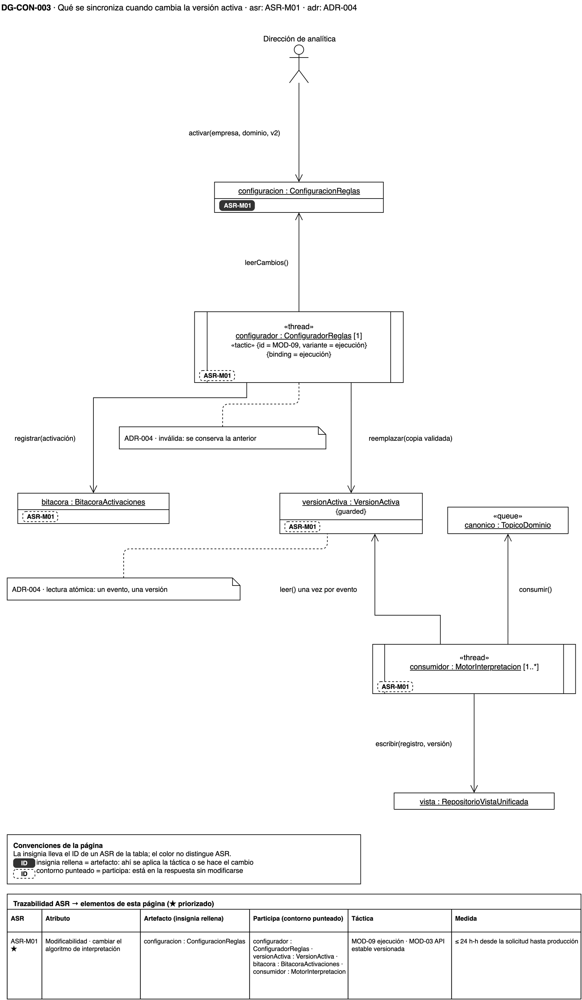

# Vista de concurrencia — plataforma de integración y analítica de la holding XYZ

## Cómo leer esta página

Esta vista responde **qué corre en paralelo y qué se sincroniza**. El primer
diagrama muestra los procesos de toda la plataforma. Los dos siguientes se
acercan a los dos momentos en que dos flujos tocan el mismo dato: el reproceso
de la cuarentena mientras siguen llegando registros nuevos, y el cambio de la
versión activa de una regla mientras el motor procesa eventos.

Las decisiones que estos diagramas dibujan están en el
[registro de ADR](adrs.md), y el índice de las cuatro vistas, en
[diagramas](diagramas.md).

{: .nota }
> Los diagramas son **vigentes**: sus ADR están aceptados. La fuente es `drawio/Reto3-Vista-Concurrencia.drawio`.

**Abrir en draw.io:** [Reto3-Vista-Concurrencia.drawio](https://app.diagrams.net/#Uhttps%3A%2F%2Fmati-mbit.github.io%2Farqsoft-reto-3%2Fmodelos%2Fdrawio%2FReto3-Vista-Concurrencia.drawio), con las 3 páginas de la vista,
en el visor de app.diagrams.net. Cada diagrama tiene además su enlace directo
bajo la imagen. La fuente versionada está en [`drawio/Reto3-Vista-Concurrencia.drawio`](drawio/Reto3-Vista-Concurrencia.drawio);
un cambio se hace ahí y se reexporta el PNG.

## Leyenda

| Símbolo | Qué significa |
|---|---|
| Caja con doble barra lateral | Un objeto activo: un proceso («process») o un hilo («thread») con su propio flujo de control |
| `[4]`, `[1..*]` | Cuántas instancias corren a la vez |
| Caja con «queue» | Un tópico o una cola del bus de eventos canónicos |
| Nombre subrayado | Una instancia, en la forma `nombre : Tipo` |
| `{guarded}` | Un recurso compartido cuyo acceso se protege |
| Flecha con rótulo | El mensaje que un objeto le envía a otro; en `consumir()` y `leer()`, la flecha va hacia la cola o el dato que se lee |
| `«tactic» {id = …, variante = …}` | La táctica del catálogo del curso que ese objeto implementa |
| Insignia rellena con el ID corto de un ASR (I01, I02, M01, M02) | El elemento es **artefacto** de ese ASR: ahí se aplica la táctica o se hace el cambio. Cada ASR tiene su color, el mismo en las cuatro vistas |
| Insignia de contorno punteado | El elemento **participa** en la respuesta de ese ASR sin modificarse |
| Tabla bajo cada diagrama | La trazabilidad de la vista: una fila por ASR, con su atributo, los elementos de la vista que son artefacto o participan, la táctica y la medida del [escenario de calidad](../quality-attributes.md). Es la misma en todas las páginas del archivo |

## DG-CON-001 · Lo que corre en paralelo

[Abrir DG-CON-001 en draw.io](https://app.diagrams.net/?page-id=dg-con-001#Uhttps%3A%2F%2Fmati-mbit.github.io%2Farqsoft-reto-3%2Fmodelos%2Fdrawio%2FReto3-Vista-Concurrencia.drawio)

**Qué muestra.** Cuatro procesos de conector, uno por cada conector del grupo (EPS, IPS, Prepagada y Seguros), más el conector empresa N,
publican en los tópicos canónicos sin coordinarse entre sí. El motor lo consume con
uno o más hilos, cada uno sobre una partición por empresa y dominio, y publica el
`RegistroUnificado`. La consolidación financiera y la venta cruzada lo consumen
cada una por su cuenta.

**Qué se sincroniza.** La escritura en la vista unificada es idempotente por
identificador de registro: un evento entregado dos veces no duplica el registro.
El orden solo se garantiza dentro de una empresa y un dominio.

**Decisión que refleja.** [ADR-003](adrs.md): el bus publicar-suscribir (MOD-04)
y la coreografía entre consumidores (INT-09).

**Qué no muestra.** Cuánto tarda un registro en llegar; eso es desempeño y queda
fuera de este reto.

## DG-CON-002 · El reproceso compite con lo nuevo

[Abrir DG-CON-002 en draw.io](https://app.diagrams.net/?page-id=dg-con-002#Uhttps%3A%2F%2Fmati-mbit.github.io%2Farqsoft-reto-3%2Fmodelos%2Fdrawio%2FReto3-Vista-Concurrencia.drawio)

**Qué muestra.** Dentro del conector de la IPS corren dos hilos. La lectura trae
los registros nuevos y rechaza a la cuarentena los que no cumplen el contrato. El
reproceso, después de ajustar el mapeo, toma los rechazados, los valida de nuevo
y los publica. Los dos publican en la misma partición del tópico canónico, y el
motor los escribe en la vista unificada.

**Qué se sincroniza.** La partición por empresa y dominio ordena lo que publican
los dos hilos, y la escritura idempotente por identificador evita que un registro
reprocesado quede dos veces.

**Decisión que refleja.** [ADR-002](adrs.md), la cuarentena con su causa y el
reproceso contra el mismo contrato (INT-04), y [ADR-003](adrs.md), la escritura
idempotente (NR-003a).

**Qué no muestra.** Qué versión gana si un rechazado se reprocesa después de que
llegó una versión más nueva del mismo registro. El ADR no lo decide, y queda en
los huecos de [diagramas](diagramas.md).

## DG-CON-003 · Cambio de versión a mitad de un lote

[Abrir DG-CON-003 en draw.io](https://app.diagrams.net/?page-id=dg-con-003#Uhttps%3A%2F%2Fmati-mbit.github.io%2Farqsoft-reto-3%2Fmodelos%2Fdrawio%2FReto3-Vista-Concurrencia.drawio)

**Qué muestra.** Dos flujos que comparten un solo recurso, la versión activa en
memoria. El configurador, en su propio hilo, lee la configuración, valida la
activación nueva, reemplaza la copia, que queda guardada en la configuración de reglas. Los
hilos del motor leen esa copia mientras consumen eventos.

**Qué se sincroniza.** La versión activa se lee una sola vez por evento, y la
copia se reemplaza entera. Así, un registro se interpreta con una sola versión
aunque la activación cambie a mitad de un lote, y la versión queda guardada con
el registro.

**Decisión que refleja.** [ADR-004](adrs.md): el ligado en ejecución (MOD-09,
variante ejecución) con recarga sin reiniciar. Si la configuración nueva no es
válida, se conserva la anterior.

**Qué no muestra.** Qué pasa si el configurador falla; es disponibilidad y queda
fuera de este reto.
