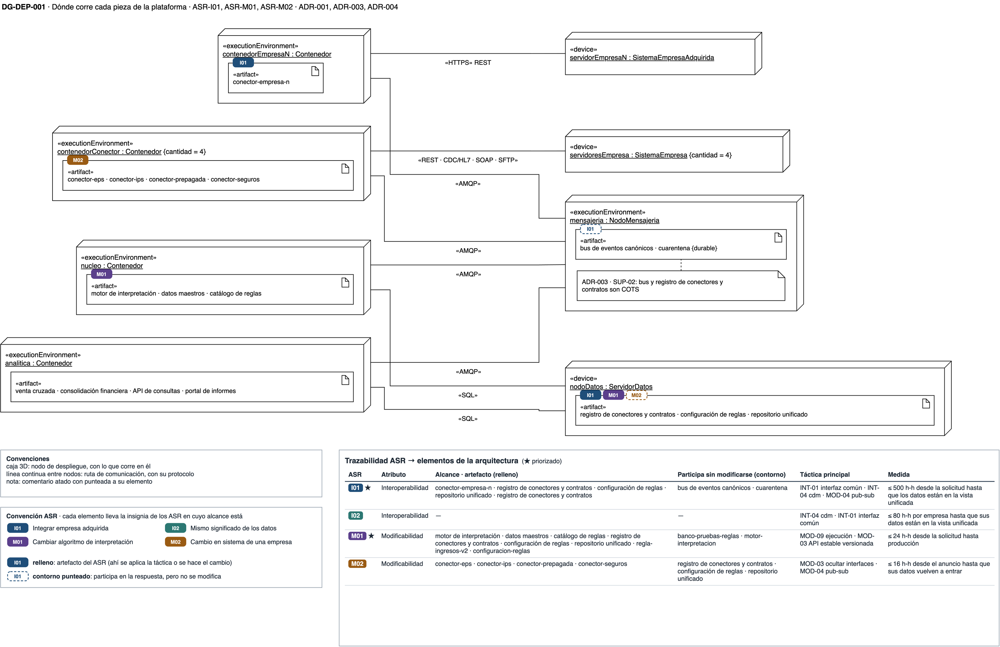
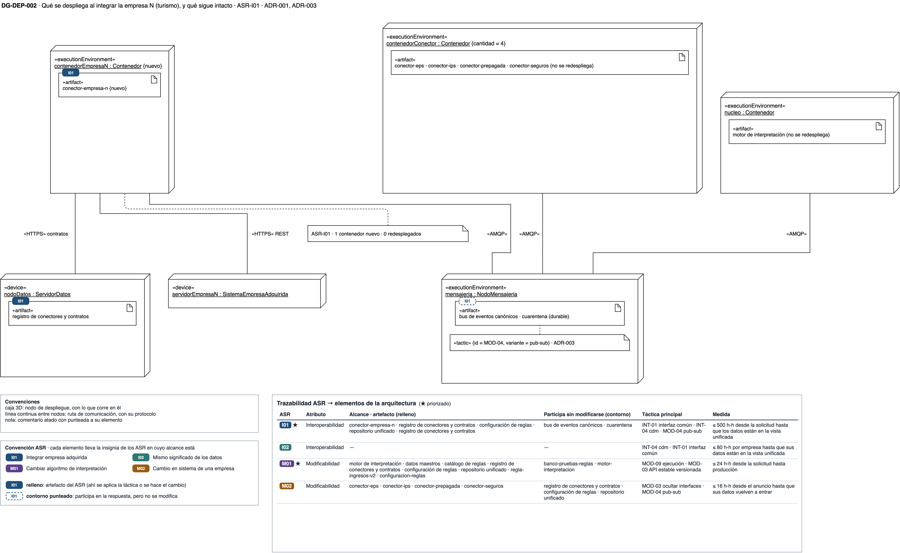
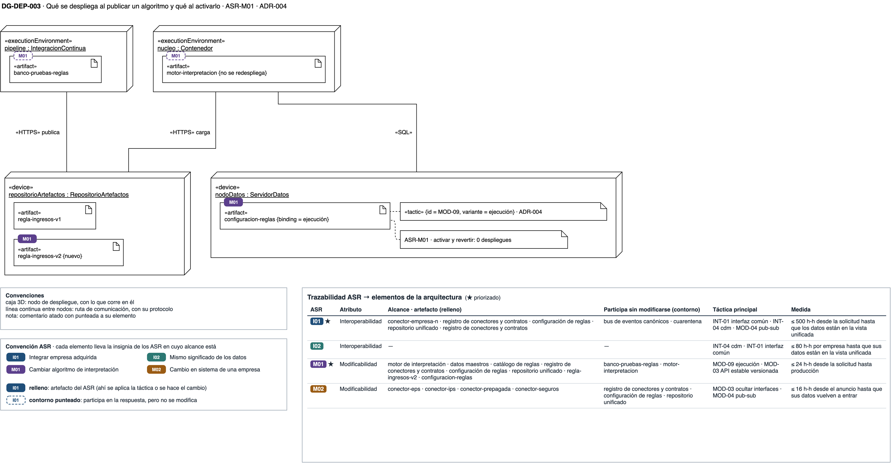

# Vista de despliegue — plataforma de integración y analítica de la holding XYZ

## Cómo leer esta página

Esta vista responde **dónde corre cada pieza y qué se despliega cuando algo
cambia**. El primer diagrama muestra la plataforma completa. Los dos siguientes
se acercan a los dos cambios que los escenarios piden: integrar la compañía de
turismo y publicar un algoritmo nuevo.

Las decisiones que estos diagramas dibujan están en el
[registro de ADR](adrs.md), y el índice de las cuatro vistas, en
[diagramas](diagramas.md).

{: .nota }
> Los diagramas son **vigentes**: sus ADR están aceptados. La fuente es `drawio/Reto3-Vista-Despliegue.drawio`. Los productos
> concretos (broker, contenedores, base de datos) y los protocolos se fijan en
> el prototipo; aquí son supuestos.

**Abrir en draw.io:** [Reto3-Vista-Despliegue.drawio](https://app.diagrams.net/#Uhttps%3A%2F%2Fmati-mbit.github.io%2Farqsoft-reto-3%2Fmodelos%2Fdrawio%2FReto3-Vista-Despliegue.drawio), con las 3 páginas de la vista,
en el visor de app.diagrams.net. Cada diagrama tiene además su enlace directo
bajo la imagen. La fuente versionada está en [`drawio/Reto3-Vista-Despliegue.drawio`](drawio/Reto3-Vista-Despliegue.drawio);
un cambio se hace ahí y se reexporta el PNG.

## Leyenda

| Símbolo | Qué significa |
|---|---|
| Caja en 3D | Un nodo: «device» es una máquina o servicio; «executionEnvironment», un entorno de ejecución como un contenedor |
| Caja con la hoja doblada | Un artefacto desplegado en el nodo que lo contiene |
| Nombre subrayado | Una instancia, en la forma `nombre : Tipo` |
| `{cantidad = 4}`, `{nuevo}`, `{no se redespliega}` | Cuántas instancias hay, qué se agrega con el cambio y qué queda igual |
| Línea con «protocolo» | Una ruta de comunicación entre nodos y su protocolo |
| Insignia rellena con el ID corto de un ASR (I01, I02, M01, M02) | El elemento es **artefacto** de ese ASR: ahí se aplica la táctica o se hace el cambio. Cada ASR tiene su color, el mismo en las cuatro vistas |
| Insignia de contorno punteado | El elemento **participa** en la respuesta de ese ASR sin modificarse |
| Tabla bajo cada diagrama | La trazabilidad de la vista: una fila por ASR, con su atributo, los elementos de la vista que son artefacto o participan, la táctica y la medida del [escenario de calidad](../quality-attributes.md). Es la misma en todas las páginas del archivo |

## DG-DEP-001 · Dónde corre cada pieza

[Abrir DG-DEP-001 en draw.io](https://app.diagrams.net/?page-id=dg-dep-001#Uhttps%3A%2F%2Fmati-mbit.github.io%2Farqsoft-reto-3%2Fmodelos%2Fdrawio%2FReto3-Vista-Despliegue.drawio)

**Qué muestra.** Cada conector corre en su propio contenedor: hay cuatro para las
empresas del grupo (EPS, IPS, Prepagada y Seguros, como en la arquitectura general) y uno para el conector empresa N, la compañía de turismo. Los de las empresas leen
sus sistemas por la interfaz que cada una publica: REST, CDC o HL7, SOAP y
archivos por SFTP. Todos publican en el nodo de mensajería, que aloja el bus de eventos
canónicos y la cuarentena. El núcleo corre el motor de interpretación, los datos
maestros y el catálogo de reglas. El nodo de datos guarda el registro de
conectores y contratos, la configuración de reglas y el repositorio unificado.
La venta cruzada, la consolidación financiera, el API de consultas y el portal
corren en el contenedor de analítica.

**Decisión que refleja.** [ADR-001](adrs.md), un conector por fuente como unidad
de despliegue propia; [ADR-003](adrs.md), el bus como intermediario; y
[ADR-004](adrs.md), el catálogo de reglas junto al motor.

**Qué no muestra.** La redundancia del nodo de mensajería y del nodo de datos; tolerar su
caída es disponibilidad y queda fuera de este reto.

## DG-DEP-002 · Qué se despliega al integrar la empresa N

[Abrir DG-DEP-002 en draw.io](https://app.diagrams.net/?page-id=dg-dep-002#Uhttps%3A%2F%2Fmati-mbit.github.io%2Farqsoft-reto-3%2Fmodelos%2Fdrawio%2FReto3-Vista-Despliegue.drawio)

**Qué muestra.** Integrar la empresa N agrega un contenedor con su conector, que lee
el sistema de reservas, trae el contrato del nodo de datos y publica en el
nodo de mensajería. La mensajería, el núcleo, el nodo de datos y los cuatro contenedores de las
empresas no se redespliegan: es la medida de ASR-I01 vista en el despliegue.

**Decisión que refleja.** [ADR-001](adrs.md) y [ADR-003](adrs.md): el conector
nuevo publica en tópicos durables que ya existen (MOD-04).

**Precio que se ve.** Una unidad de despliegue más por cada fuente, y un bus
del que dependen todos.

## DG-DEP-003 · Qué se despliega al publicar un algoritmo

[Abrir DG-DEP-003 en draw.io](https://app.diagrams.net/?page-id=dg-dep-003#Uhttps%3A%2F%2Fmati-mbit.github.io%2Farqsoft-reto-3%2Fmodelos%2Fdrawio%2FReto3-Vista-Despliegue.drawio)

**Qué muestra.** Cada versión de una regla es un artefacto propio en el
repositorio de artefactos. El pipeline publica la versión 2 después de correr el
banco de pruebas, y el motor la carga desde el repositorio sin redesplegarse.
Qué versión opera para cada empresa lo dice la configuración de reglas, en el
nodo de datos, que también guarda quién activó o revirtió y cuándo.

**Qué cambia al activar o revertir.** Solo un dato en la configuración de
reglas; no se despliega nada.

**Decisión que refleja.** [ADR-004](adrs.md): el ligado en ejecución (MOD-09,
variante ejecución).

**Precio que se ve.** El mecanismo de carga de artefactos y de recarga en
caliente que el motor necesita.
