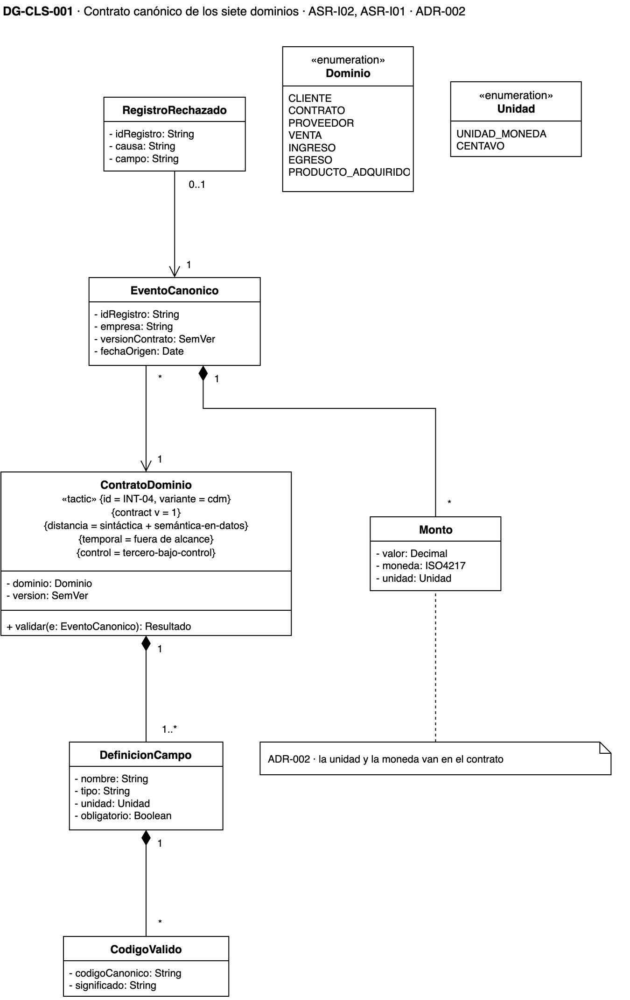
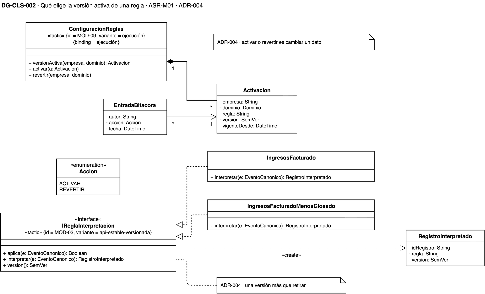
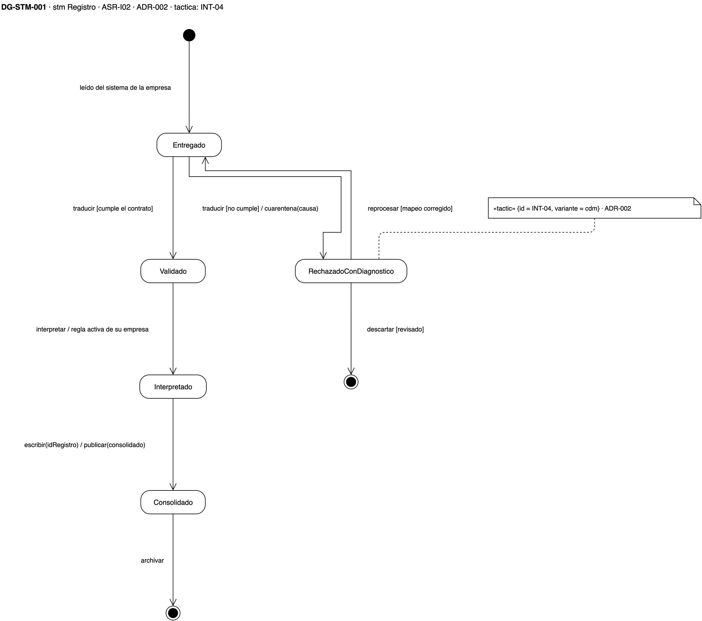
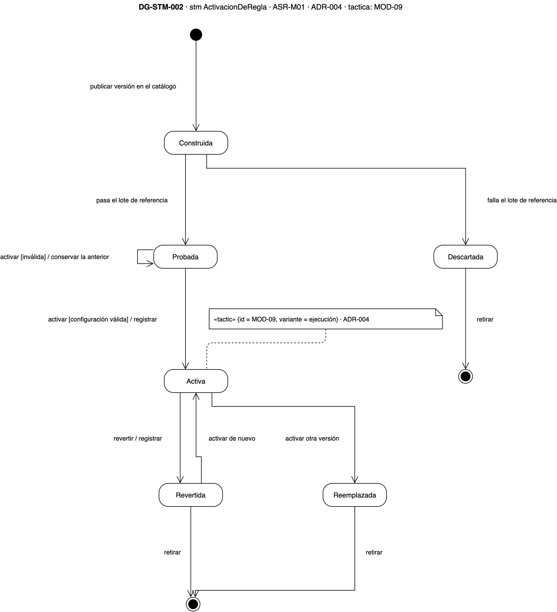

# Vista de información — plataforma de integración y analítica de la holding XYZ

## Cómo leer esta página

Esta vista responde **qué datos existen y por qué estados pasan**. Abre con el
contrato canónico de los siete dominios, que es lo que comparten todas las
empresas, y sigue con la configuración de reglas y los dos ciclos de vida que
importan para los escenarios: el de un registro y el de la activación de una
regla.

Las decisiones que estos diagramas dibujan están en el
[registro de ADR](adrs.md). El vocabulario (entregado, interpretado, rechazado
con diagnóstico, consolidado) está fijado en el [glosario](../glossary.md).

{: .nota }
> Los diagramas son **vigentes**: sus ADR están aceptados. La fuente es `drawio/Reto3-Vista-Informacion.drawio`.

## Leyenda

| Símbolo | Qué significa |
|---|---|
| Clase con tres compartimentos | Nombre, atributos y operaciones; `-` privado, `+` público |
| «interface», «enumeration» | Una interfaz, o una lista cerrada de valores |
| Rombo lleno | Composición: la parte no existe sin el todo |
| Flecha abierta | Asociación navegable, con la multiplicidad en cada extremo |
| Triángulo hueco punteado | Realización: la clase cumple la interfaz |
| Rectángulo redondeado | Un estado; las flechas son transiciones con `evento [guarda] / acción` |
| Círculo lleno y círculo con anillo | Estado inicial y estado final |

## DG-CLS-001 · El contrato canónico

**Qué muestra.** Cada dominio tiene un contrato versionado que define sus campos,
con tipo y unidad, y los códigos válidos de cada uno. Todo evento canónico dice
contra qué versión del contrato se validó. El monto lleva su valor, su moneda y
su unidad, de modo que «1500» no se puede leer como pesos y como centavos a la
vez. Un registro rechazado guarda la causa y el campo que falló.

**Decisión que refleja.** [ADR-002](adrs.md): el modelo canónico declarado en un
contrato (INT-04, modelo canónico).

**Qué no muestra.** Los campos de cada dominio uno por uno; los fija cada
contrato.

## DG-CLS-002 · La configuración de reglas

**Qué muestra.** Las dos versiones del algoritmo de ingresos, lo facturado y lo
facturado menos lo glosado, realizan la misma interfaz. La configuración guarda
una activación por empresa y dominio, con la versión vigente. Cada activación o
reversión queda en la bitácora, con su autor y su fecha. Cada registro
interpretado guarda la regla y la versión que lo produjeron.

**Decisión que refleja.** [ADR-004](adrs.md): la interfaz estable y versionada
(MOD-03) y la versión activa como un dato (MOD-09).

**Qué no muestra.** Cómo se implementa cada algoritmo.

## DG-STM-001 · El ciclo de un registro

**Qué muestra.** Un registro leído del sistema de su empresa queda entregado. Si
cumple el contrato se valida, se interpreta con la regla activa de su empresa y
se consolida. Si no lo cumple, queda rechazado con diagnóstico, y desde ahí se
reprocesa cuando se corrige el mapeo o se descarta tras revisarlo.

**Decisión que refleja.** [ADR-002](adrs.md): no hay ningún camino por el que un
registro llegue a consolidado sin cumplir el contrato.

**Qué no muestra.** Quién revisa la cuarentena; es una pregunta abierta del
[registro de ADR](adrs.md).

## DG-STM-002 · El ciclo de una activación

**Qué muestra.** Una versión publicada en el catálogo se prueba contra su lote
de referencia: si falla, se descarta, y si pasa, queda lista para activar.
Activarla con una configuración inválida no cambia nada y se conserva la
anterior. Una versión activa se puede revertir o reemplazar, y una revertida se
puede activar de nuevo.

**Decisión que refleja.** [ADR-004](adrs.md): activar y revertir son transiciones
sobre un dato, sin despliegue (MOD-09).

**Qué no muestra.** El tiempo que toma cada transición.
