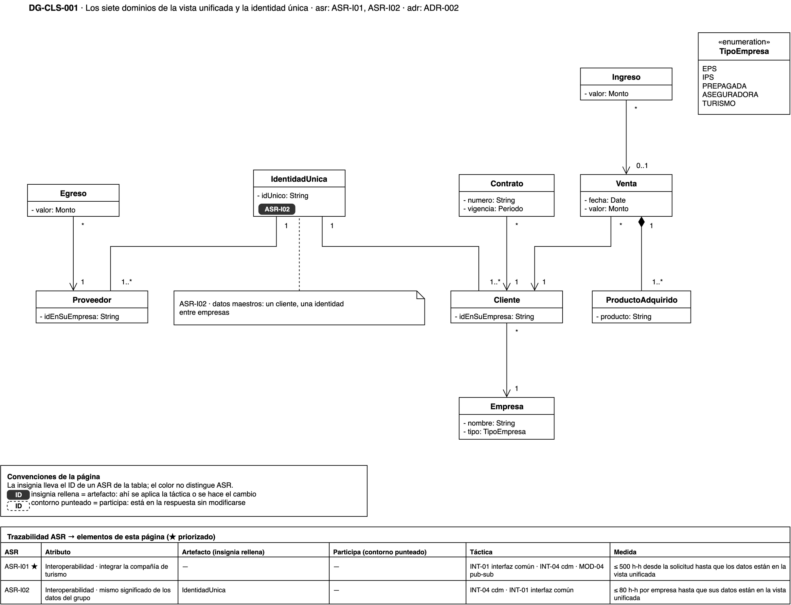
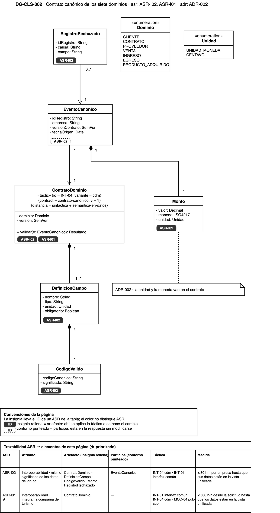
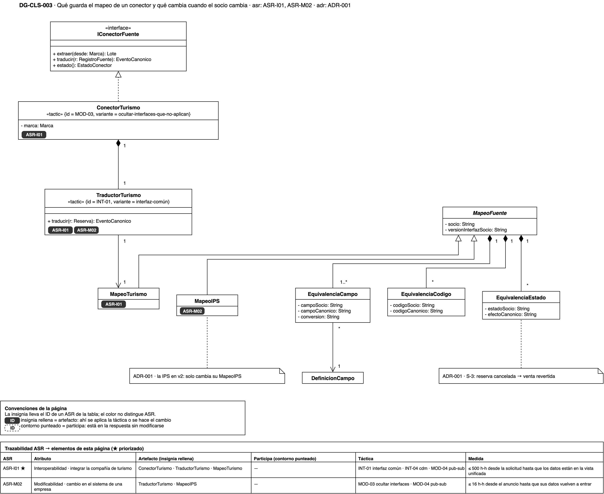
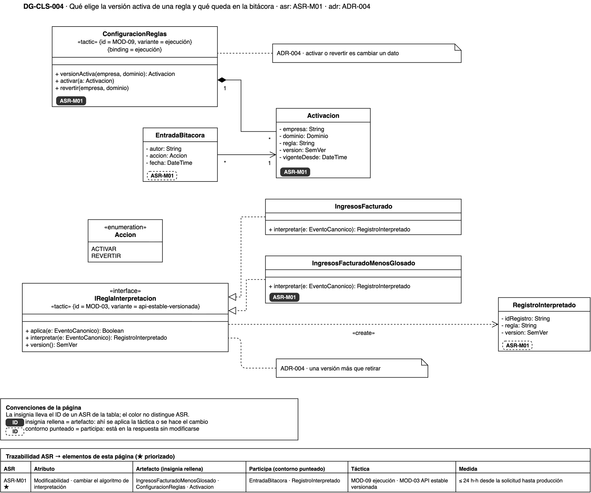
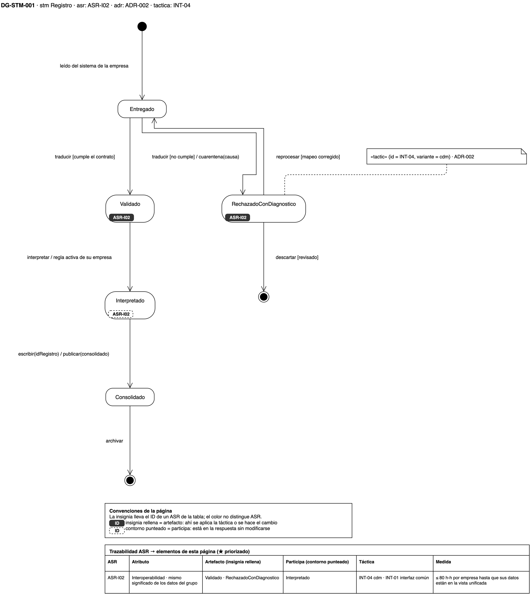
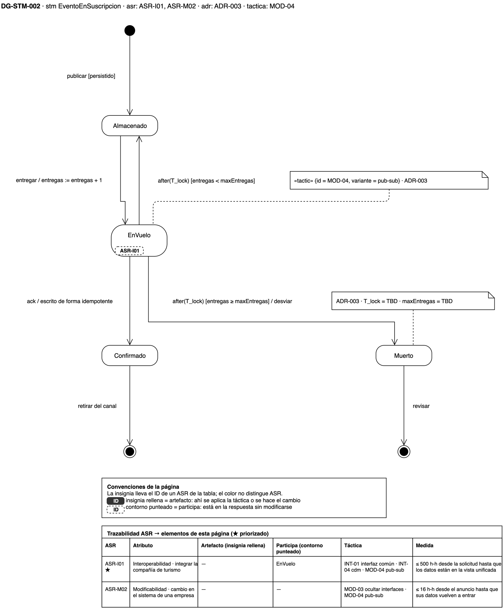
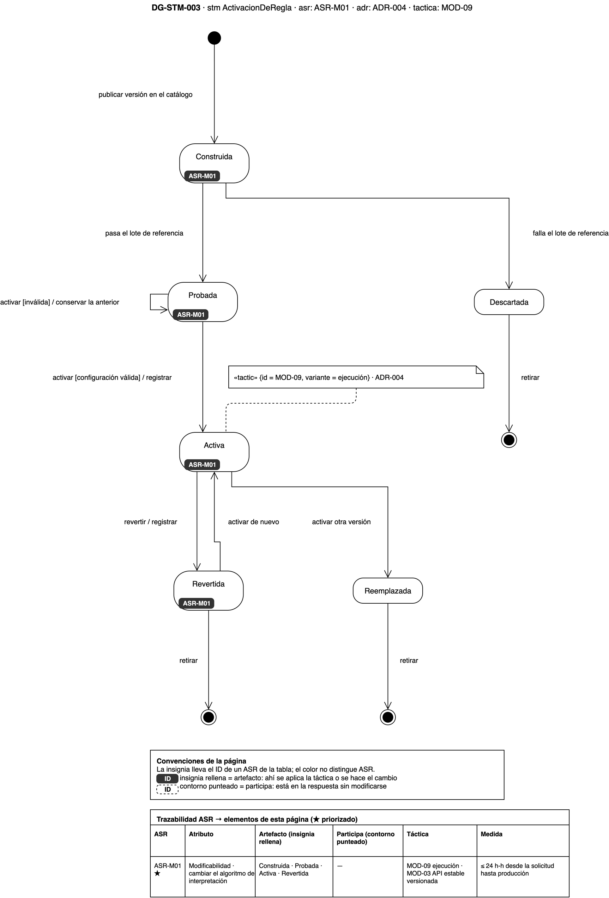

# Vista de información — plataforma de integración y analítica de la holding XYZ

## Cómo leer esta página

Esta vista responde **qué datos existen y por qué estados pasan**. Abre con los
siete dominios de la vista unificada, que es lo que comparten todas las empresas,
y sigue con un acercamiento por táctica. Tres diagramas de clases muestran el
contrato canónico, el mapeo de un conector y la configuración de reglas. Tres
máquinas de estados muestran el ciclo de un registro, el de un evento en su
suscripción y el de la activación de una regla.

Las decisiones que estos diagramas dibujan están en el
[registro de ADR](adrs.md). El vocabulario (entregado, interpretado, rechazado
con diagnóstico, consolidado) está fijado en el [glosario](../glossary.md).

{: .nota }
> Los diagramas son **vigentes**: sus ADR están aceptados. La fuente es `drawio/Reto3-Vista-Informacion.drawio`.

**Abrir en draw.io:** [Reto3-Vista-Informacion.drawio](https://app.diagrams.net/#Uhttps%3A%2F%2Fmati-mbit.github.io%2Farqsoft-reto-3%2Fmodelos%2Fdrawio%2FReto3-Vista-Informacion.drawio), con las 7 páginas de la vista,
en el visor de app.diagrams.net. Cada diagrama tiene además su enlace directo
bajo la imagen. La fuente versionada está en [`drawio/Reto3-Vista-Informacion.drawio`](drawio/Reto3-Vista-Informacion.drawio);
un cambio se hace ahí y se reexporta el PNG.

## Leyenda

| Símbolo | Qué significa |
|---|---|
| Clase con tres compartimentos | Nombre, atributos y operaciones; `-` privado, `+` público; en cursiva, una clase abstracta |
| «interface», «enumeration» | Una interfaz, o una lista cerrada de valores |
| Rombo lleno | Composición: la parte no existe sin el todo |
| Flecha abierta | Asociación navegable, con la multiplicidad en cada extremo |
| Triángulo hueco | Generalización (línea continua) o realización de una interfaz (línea punteada) |
| Rectángulo redondeado | Un estado; las flechas son transiciones con `evento [guarda] / acción` |
| Círculo lleno y círculo con anillo | Estado inicial y estado final |
| `TBD` | Un parámetro que el ADR todavía no fija |
| Insignia rellena con el ID de un ASR | El elemento es **artefacto** de ese ASR: ahí se aplica la táctica o se hace el cambio |
| Insignia de contorno punteado | El elemento **participa** en la respuesta de ese ASR sin modificarse |
| Tabla bajo cada diagrama | La trazabilidad de la página: por ASR, su atributo, qué es artefacto, qué participa, la táctica y la medida del [escenario de calidad](../quality-attributes.md) |

## DG-CLS-001 · Los siete dominios de la vista unificada

[Abrir DG-CLS-001 en draw.io](https://app.diagrams.net/?page-id=dg-cls-001#Uhttps%3A%2F%2Fmati-mbit.github.io%2Farqsoft-reto-3%2Fmodelos%2Fdrawio%2FReto3-Vista-Informacion.drawio)

**Qué muestra.** Los siete dominios que se integran de todas las empresas:
cliente, contrato, proveedor, venta, ingreso, egreso y producto adquirido. Cada
cliente pertenece a una empresa del grupo, y los datos maestros le dan una
identidad única que lo reconoce en las demás. Lo mismo pasa con el proveedor. Una
venta se compone de sus productos adquiridos, y un ingreso puede venir de una
venta.

**Decisión que refleja.** [ADR-002](adrs.md): este es el modelo que comparten
todas las empresas, y cada dominio tiene su contrato (DG-CLS-002).

**Qué no muestra.** Los campos de cada dominio uno por uno, que los fija cada
contrato. Las asociaciones entre dominios son la lectura de este diagrama sobre
el enunciado; el contrato de cada dominio las confirma o las corrige.

## DG-CLS-002 · El contrato canónico

[Abrir DG-CLS-002 en draw.io](https://app.diagrams.net/?page-id=dg-cls-002#Uhttps%3A%2F%2Fmati-mbit.github.io%2Farqsoft-reto-3%2Fmodelos%2Fdrawio%2FReto3-Vista-Informacion.drawio)

**Qué muestra.** Cada dominio tiene un contrato versionado que define sus campos,
con tipo y unidad, y los códigos válidos de cada uno. Todo evento canónico dice
contra qué versión del contrato se validó. El monto lleva su valor, su moneda y
su unidad, de modo que «1500» no se puede leer como pesos y como centavos a la
vez. Un registro rechazado guarda la causa y el campo que falló.

**Decisión que refleja.** [ADR-002](adrs.md): el modelo canónico declarado en un
contrato (INT-04, modelo canónico).

**Qué no muestra.** Los campos de cada dominio uno por uno; los fija cada
contrato.

## DG-CLS-003 · El mapeo de un conector

[Abrir DG-CLS-003 en draw.io](https://app.diagrams.net/?page-id=dg-cls-003#Uhttps%3A%2F%2Fmati-mbit.github.io%2Farqsoft-reto-3%2Fmodelos%2Fdrawio%2FReto3-Vista-Informacion.drawio)

**Qué muestra.** El conector de turismo realiza el puerto común
`IConectorFuente` y contiene su traductor, que usa el mapeo de turismo. Todo
mapeo guarda la versión de la interfaz del socio y tres tablas de equivalencias:
de campos, de códigos y de estados. La de campos apunta a la definición del
contrato canónico. La de estados es la que traduce una reserva cancelada como
venta revertida.

**Decisión que refleja.** [ADR-001](adrs.md): el traductor cierra las distancias
(INT-01), y lo que sabe del socio queda escondido en su mapeo (MOD-03). Cuando la
IPS publica la versión 2 de su interfaz, solo cambia su mapeo.

**Qué no muestra.** Cómo se lee el sistema del socio; lo muestra
[DG-CST-001](vista-componentes.md).

## DG-CLS-004 · La configuración de reglas

[Abrir DG-CLS-004 en draw.io](https://app.diagrams.net/?page-id=dg-cls-004#Uhttps%3A%2F%2Fmati-mbit.github.io%2Farqsoft-reto-3%2Fmodelos%2Fdrawio%2FReto3-Vista-Informacion.drawio)

**Qué muestra.** Las dos versiones del algoritmo de ingresos, lo facturado y lo
facturado menos lo glosado, realizan la misma interfaz. La configuración guarda
una activación por empresa y dominio, con la versión vigente. Cada activación o
reversión queda en la bitácora, con su autor y su fecha. Cada registro
interpretado guarda la regla y la versión que lo produjeron.

**Decisión que refleja.** [ADR-004](adrs.md): la interfaz estable y versionada
(MOD-03) y la versión activa como un dato (MOD-09).

**Qué no muestra.** Cómo se implementa cada algoritmo.

## DG-STM-001 · El ciclo de un registro

[Abrir DG-STM-001 en draw.io](https://app.diagrams.net/?page-id=dg-stm-001#Uhttps%3A%2F%2Fmati-mbit.github.io%2Farqsoft-reto-3%2Fmodelos%2Fdrawio%2FReto3-Vista-Informacion.drawio)

**Qué muestra.** Un registro leído del sistema de su empresa queda entregado. Si
cumple el contrato se valida, se interpreta con la regla activa de su empresa y
se consolida. Si no lo cumple, queda rechazado con diagnóstico, y desde ahí se
reprocesa cuando se corrige el mapeo o se descarta tras revisarlo.

**Decisión que refleja.** [ADR-002](adrs.md): no hay ningún camino por el que un
registro llegue a consolidado sin cumplir el contrato.

**Qué no muestra.** Quién revisa la cuarentena; es una pregunta abierta del
[registro de ADR](adrs.md).

## DG-STM-002 · El ciclo de un evento en su suscripción

[Abrir DG-STM-002 en draw.io](https://app.diagrams.net/?page-id=dg-stm-002#Uhttps%3A%2F%2Fmati-mbit.github.io%2Farqsoft-reto-3%2Fmodelos%2Fdrawio%2FReto3-Vista-Informacion.drawio)

**Qué muestra.** El bus guarda el evento publicado hasta entregarlo. Mientras el
consumidor lo procesa, el evento está en vuelo; si confirma, queda confirmado, y
si no confirma a tiempo, vuelve a quedar disponible y se entrega de nuevo. Pasado
el máximo de entregas, el evento se desvía para revisarlo. Como un evento puede
llegar dos veces, el motor escribe de forma idempotente.

**Decisión que refleja.** [ADR-003](adrs.md): el tema es un canal durable
(MOD-04, publicar-suscribir), y lo que se entrega dos veces no duplica el
registro (NR-003a).

**Qué no muestra.** Los valores de `T_lock` y de `maxEntregas`. El ADR no los
fija y van `TBD`; los fija el prototipo.

## DG-STM-003 · El ciclo de una activación

[Abrir DG-STM-003 en draw.io](https://app.diagrams.net/?page-id=dg-stm-003#Uhttps%3A%2F%2Fmati-mbit.github.io%2Farqsoft-reto-3%2Fmodelos%2Fdrawio%2FReto3-Vista-Informacion.drawio)

**Qué muestra.** Una versión publicada en el catálogo se prueba contra su lote
de referencia: si falla, se descarta, y si pasa, queda lista para activar.
Activarla con una configuración inválida no cambia nada y se conserva la
anterior. Una versión activa se puede revertir o reemplazar, y una revertida se
puede activar de nuevo.

**Decisión que refleja.** [ADR-004](adrs.md): activar y revertir son transiciones
sobre un dato, sin despliegue (MOD-09).

**Qué no muestra.** El tiempo que toma cada transición.
