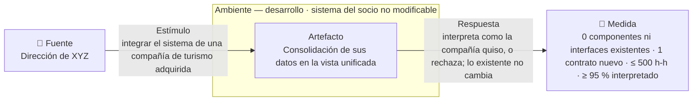
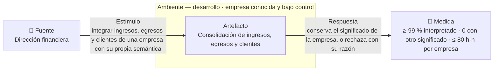
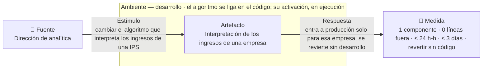
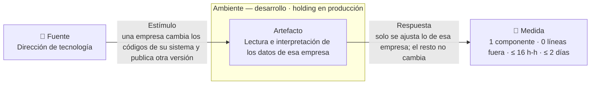

# Escenarios de calidad — interoperabilidad y modificabilidad

Esta página fija los cuatro requisitos de calidad significativos para la
arquitectura (ASR) del sistema que integra los datos de la holding XYZ. Dos son
de interoperabilidad y dos de modificabilidad, que son los atributos del reto.

Cada ASR dice qué tan bien tiene que responder el sistema, no cómo lo logra. Un
conector, un modelo canónico, un bus o un catálogo de reglas son soluciones, y
las eligen las [decisiones de arquitectura](modelos/adrs.md). El vocabulario
está fijado en el [glosario](glossary.md).

## 1. Los cuatro ASR

| ID | Atributo | Enunciado corto | Prioridad | Impacto |
|---|---|---|---|---|
| **ASR-I01** | Interoperabilidad | Integrar una compañía de turismo adquirida no modifica nada de lo existente, cuesta ≤ 500 h-h y deja interpretado ≥ 95 % de sus datos | Alta | Alto |
| ASR-I02 | Interoperabilidad | Los datos de las empresas del grupo se interpretan con el significado que cada una les dio: ≥ 99 % interpretado y 0 registros con otro significado | Alta | Medio |
| **ASR-M01** | Modificabilidad | Cambiar el algoritmo que interpreta los ingresos de una empresa toca un solo componente, cuesta ≤ 24 h-h y se revierte sin desarrollo | Alta | Alto |
| ASR-M02 | Modificabilidad | Un cambio de una empresa en su propio sistema se absorbe tocando un solo componente, en ≤ 16 h-h | Alta | Medio |

La prioridad mide la importancia para el negocio, y el impacto, la dificultad de
lograrlo. En negrilla están los dos que se validan con juicio de expertos, uno
por atributo, como pide el curso; la sección 3 explica por qué esos dos.

El enunciado del reto no trae cifras de esfuerzo, tiempo ni porcentaje: solo
cuenta ocho empresas y siete dominios de datos. Las demás cifras son supuestos,
y la sección 5 dice de dónde sale cada uno y quién debe confirmarlo.

## 2. Las fichas

### ASR-I01 — Integrar una compañía de turismo adquirida

**Historia que lo origina.** [HU-03](requirements.md): como dirección de XYZ,
quiero integrar a la vista unificada una compañía de turismo adquirida sin
alterar lo que ya funciona, para leer sus datos junto con los del resto de la
holding.

| Parte | Contenido |
|---|---|
| Fuente | La dirección de XYZ, después de adquirir una compañía de turismo |
| Estímulo | Integrar el sistema de reservas y facturación de la compañía, que está en producción, es de otro proveedor y usa sus propios campos, códigos de cliente y moneda |
| Artefacto | La consolidación de los datos de la compañía en la vista unificada: clientes, ventas, ingresos, egresos y productos adquiridos |
| Ambiente | En desarrollo. La holding conoce el sistema de la compañía en la debida diligencia, y no lo puede modificar |
| Respuesta | Los datos de la compañía quedan en la vista unificada con el significado que ella les dio, o se rechazan con su razón. Lo que ya funciona para las ocho empresas del grupo no cambia |
| Medida | 0 componentes ni interfaces existentes modificados o redesplegados, y 1 contrato de integración nuevo · ≤ 500 h-h desde la solicitud hasta que los datos están en la vista unificada · ≥ 95 % de los registros interpretados, y 0 registrados con otro significado |

**Por qué es significativo.** Un contrato de integración es la descripción
acordada de qué entrega la compañía, con qué forma y con qué significado. Pedir
que la compañía entre con su contrato y sin cambiar nada de lo existente obliga
a decidir si cada socio nuevo se suma por su cuenta o si su llegada toca lo que
ya funciona. Con N adquisiciones, esa decisión es la diferencia
entre sumar N contratos y hacer N cambios sobre el sistema en producción.

**Cómo se cuenta el porcentaje.** Sobre un lote de referencia que firma la
dirección financiera, con los registros de un mes de reservas y facturación de
la compañía (S-8). Un registro cuenta como interpretado si su moneda, su código
de cliente y el estado de la reserva coinciden con los del lote.

**Cómo se verifica.** Con juicio de expertos (sección 6) y, como complemento, un
experimento que integra una compañía simulada y cuenta en el diff los
componentes nuevos y los modificados, las h-h y el porcentaje interpretado.

### ASR-I02 — Interpretar con el mismo significado los datos de las empresas del grupo

**Historia que lo origina.** [HU-10](requirements.md): como dirección
financiera, quiero los ingresos y egresos de todas las empresas unificados, para
consolidar las cifras de la holding sin procesos manuales.

| Parte | Contenido |
|---|---|
| Fuente | La dirección financiera de la holding |
| Estímulo | Integrar los ingresos, egresos y clientes de una empresa del grupo, que los registra con su propia semántica: tipos de documento distintos, códigos de estado propios, montos en otra unidad y fechas en formato local |
| Artefacto | La consolidación de ingresos, egresos y clientes de esa empresa en la vista unificada |
| Ambiente | En desarrollo. La empresa se conoce de antemano, y la holding manda sobre ella pero no sobre el producto de su proveedor |
| Respuesta | Cada registro queda con el significado que le dio su empresa, o se rechaza con su razón |
| Medida | ≥ 99 % de los registros interpretados · 0 registros con otro significado · ≤ 80 h-h por empresa, desde la solicitud hasta que sus datos están en la vista unificada |

**Por qué es significativo.** Un monto en centavos que entra como si fueran pesos
no lo detecta ninguna validación de formato: el dato tiene el tipo correcto y el
significado equivocado. Este ASR obliga a decidir dónde se declara el
significado de cada campo, con su unidad, su moneda y sus códigos, y qué ruta
sigue el registro que no lo cumple. El formato lo valida una herramienta; el
significado solo lo fija un acuerdo con cada empresa, y por eso es lo que más
tarda en cerrarse.

**Cómo se cuenta el porcentaje.** Sobre un lote de referencia que firma la
dirección financiera, con los registros de un mes de la empresa (S-12). Un
registro cuenta como interpretado si el monto queda en su unidad y su moneda, y
si el tipo de documento, el código de estado y la fecha coinciden con los del
lote.

**Cómo se verifica.** Con un experimento sobre un lote de referencia que trae
registros ambiguos a propósito, como montos en centavos. Se cuentan los
interpretados, los rechazados con su razón y los que entraron con otro
significado. Este ASR no va en la encuesta de expertos.

### ASR-M01 — Cambiar el algoritmo que interpreta los ingresos de una empresa

**Historia que lo origina.** [HU-07](requirements.md): como dirección de
analítica, quiero cambiar el algoritmo que interpreta los ingresos de una
empresa, y volver al anterior si no sirve, para ajustarlo sin alterar a las
demás empresas.

| Parte | Contenido |
|---|---|
| Fuente | La dirección de analítica de la holding |
| Estímulo | Cambiar el algoritmo que interpreta los ingresos de una IPS, una de las clínicas u hospitales del grupo. Hoy se toma lo facturado, y la holding decide restarle lo glosado: el valor que el pagador objeta y la IPS puede no recibir |
| Artefacto | La interpretación de los ingresos de una empresa del grupo |
| Ambiente | Desarrollo, con el sistema en producción. El algoritmo nuevo se liga en el código; su activación para una empresa y su reversión se ligan en ejecución, sin redesplegar |
| Respuesta | El algoritmo nuevo se prueba y entra a producción solo para esa empresa. Las otras siete no cambian, y volver al algoritmo anterior no requiere desarrollo |
| Medida | 1 componente nuevo o modificado · 0 líneas de código tocadas fuera de él · ≤ 24 h-h y ≤ 3 días hábiles desde la solicitud hasta producción · revertir: 0 líneas de código y ≤ 1 h-h |

**Por qué es significativo.** El enunciado anuncia que estos cambios serán
frecuentes, y dice que hoy cada cambio en el análisis cuesta más de lo esperado.
Obliga a decidir dónde vive cada algoritmo y si elegir cuál opera para una
empresa es código o configuración; si el algoritmo cambiara una vez al año,
aislarlo sería sobreingeniería.

**Cómo se verifica.** Con juicio de expertos (sección 6) y, como complemento, un
experimento que hace tres cambios de algoritmo y cuenta, en cada diff, los
componentes y las líneas tocadas fuera del nuevo, las h-h y lo que cuesta
revertir.

### ASR-M02 — Absorber el cambio de una empresa en su propio sistema

**Historia que lo origina.** [HU-05](requirements.md): como dirección de
tecnología, quiero que un cambio en el sistema de una empresa solo afecte la
interpretación de esa empresa, para no rehacer la de las demás.

| Parte | Contenido |
|---|---|
| Fuente | La dirección de tecnología, cuando una empresa del grupo anuncia que actualiza su sistema; por ejemplo, una IPS que cambia de versión su sistema de facturación |
| Estímulo | La empresa cambia sus códigos de estado de facturación y publica una versión nueva de su interfaz |
| Artefacto | La lectura e interpretación de los datos de esa empresa |
| Ambiente | En desarrollo, con el sistema de la holding en producción |
| Respuesta | Solo se ajusta lo que lee los datos de esa empresa. El significado de los siete dominios no cambia, y la consolidación, los informes y las otras siete empresas siguen iguales |
| Medida | 1 componente modificado · 0 líneas de código tocadas fuera de él · ≤ 16 h-h y ≤ 2 días hábiles desde que la empresa anuncia el cambio hasta que sus datos vuelven a entrar |

**Por qué es significativo.** Este cambio no lo decide la holding: lo decide la
empresa, y según el enunciado ocurrirá en todas. En ASR-M01 la holding cambia lo
suyo y busca que no se propague; aquí cambia un tercero, y la holding busca que
el cambio no la alcance. Si la lógica de la holding
leyera directamente los códigos de cada empresa, cada actualización de un
proveedor tocaría todas las funciones que los interpretan. Obliga a decidir
dónde termina lo que es de cada empresa y dónde empieza lo que comparten todas.

**Cómo se verifica.** Con un experimento que ensaya el cambio de códigos en una
IPS simulada y cuenta en el diff los componentes y las líneas tocadas fuera del
modificado, más las h-h y los días. Este ASR no va en la encuesta de expertos.

## 3. Por qué ASR-I01 y ASR-M01 van a la validación

El curso pide validar con juicio de expertos un escenario por atributo (R-9 en
[restricciones](constraints.md)). Los dos elegidos son los que más arquitectura
deciden.

**ASR-I01 y no ASR-I02.**

1. **Es el motivo de la arquitectura.** El enunciado pone las adquisiciones
   futuras y el reemplazo de sistemas en producción como la razón para
   rediseñar. ASR-I02 protege la calidad del dato, pero no define la forma del
   sistema.
2. **Decide más.** ASR-I01 obliga a elegir cómo entra cualquier socio nuevo.
   ASR-I02 se apoya en esa misma decisión y le suma una regla: dónde se declara
   el significado de cada campo.
3. **Es el que más cuesta si llega sin preparar.** La holding ya anunció las
   compras, así que es probable; y si cada compra toca el sistema existente, el
   costo crece con cada una.

**ASR-M01 y no ASR-M02.**

1. **Frecuencia.** El enunciado dice de forma explícita que los cambios de
   algoritmo serán frecuentes.
2. **Una decisión que nadie más fuerza.** Buena parte de ASR-M02 la resuelve la
   misma frontera con cada socio que exige ASR-I01. ASR-M01, en cambio, obliga a
   decidir cómo se elige y se revierte un algoritmo, y ningún otro ASR lo pide.
3. **Riesgo.** Un algoritmo mal activado corrompe la interpretación de una
   empresa entera, y por eso volver atrás sin desarrollo es parte de la medida.

## 4. El ambiente de cada atributo

Estos ASR no se miden bajo carga, sino mientras se construye el cambio. Por eso
los cuatro entran a Helix con **TPS = 0**.

En **modificabilidad** se juzga el trabajo de cambiar el sistema, así que el
ambiente siempre es desarrollo, aunque el sistema siga en producción mientras
tanto. Lo que varía es en qué momento se liga el cambio: en el código, en la
compilación, en el despliegue o en ejecución. Cambiar código cuesta más que
cambiar un dato, y por eso el momento de ligado cambia el costo.

La tabla trae un cambio probable por tipo, no todos los posibles: diseñar para
cualquier cambio es sobreingeniería. La columna «Viene de» dice quién origina el
cambio, porque no se contiene igual un cambio propio que uno de un tercero.

| Cambio probable | Tipo | Viene de | Cuándo se liga | Resultado |
|---|---|---|---|---|
| Cambiar el algoritmo que interpreta los datos de una empresa | Adaptativo | El negocio de la holding | El algoritmo, en el código; su activación y su reversión, en ejecución | **ASR-M01** |
| Absorber el cambio de una empresa en su propio sistema | Adaptativo | Un tercero: la empresa y su proveedor | En el código | **ASR-M02** |
| Corregir una regla mal aplicada y recalcular su histórico | Correctivo | La holding | En el código | No es ASR aparte: lo resuelve la misma decisión que ASR-M01 |
| Unificar un indicador, como el ingreso neto, que hoy se calcula distinto en varios análisis | Preventivo | La holding | En el código | Candidato para otra iteración |
| Cambiar la presentación de los informes para directivos | Aditivo | Los directivos de XYZ | En el despliegue | Candidato: tiene menos peso en la estructura que los dos adaptativos |

**La medida principal es de estructura.** En ASR-I01, ASR-M01 y ASR-M02 se mide
primero cuántos componentes o interfaces existentes toca el cambio. Un «1
componente tocado» solo se cumple si el diseño deja ese cambio contenido, y por
eso esa medida es la que se puede exigirle a la arquitectura. Las h-h la
acompañan sin reemplazarla: solas dependen del tamaño del cambio y del equipo.
En ASR-I02 la medida principal es el porcentaje interpretado, porque lo que está
en juego es el significado del dato y no la propagación.

En **interoperabilidad**, el ambiente dice cuándo conoce la holding al socio y
cuánto control tiene sobre él. Los cuatro escenarios se miden en desarrollo.

| Socio | Cuándo lo conoce la holding | Control sobre su sistema |
|---|---|---|
| Compañía de turismo adquirida | En la debida diligencia | Ninguno: está en producción, es de otro proveedor y no se modifica |
| Compañía de salud adquirida | En la debida diligencia | Ninguno |
| Empresas del grupo | De antemano | Manda sobre la empresa, no sobre el producto de su proveedor |
| Sistema de reemplazo de una empresa, como un ERP nuevo | De antemano | Ninguno |

## 5. De dónde sale cada cifra

En los cuatro escenarios, el cambio lo hace el equipo de desarrollo de la holding, que
conoce su sistema y no el de cada empresa (S-4 en [restricciones](constraints.md)).
Las cifras que el enunciado no trae son supuestos, numerados en continuación de
los de esa página.

| # | Supuesto | Por qué es razonable | Lo confirma |
|---|---|---|---|
| S-6 | El equipo es de 2 desarrolladores, con 8 h por día hábil y 22 días hábiles al mes | Es la escala mínima para absorber cambios frecuentes sin depender de cada empresa | Dirección de tecnología |
| S-7 | Integrar la compañía de turismo cuesta ≤ 500 h-h, unos 31 días hábiles del equipo | En la clase del 13 de octubre, el profesor usó esta misma holding como ejemplo: integrar las agencias de viajes que compra en menos de 500 horas | Dirección de estrategia |
| S-8 | De sus datos se interpreta ≥ 95 %, y el resto se rechaza con su razón. Se cuenta sobre los registros de un mes | Es la pérdida aceptable que la misma clase planteó para las agencias: un 5 % | Dirección financiera |
| S-9 | Un cambio de algoritmo toca 1 componente y 0 líneas fuera de él | Son cambios frecuentes: si cada uno se riega por el sistema, el equipo pasa el tiempo corrigiendo lo que rompió | Dirección de tecnología |
| S-10 | Un algoritmo nuevo llega a producción en ≤ 3 días hábiles y ≤ 24 h-h | Cabe en una semana y deja margen antes del cierre mensual. Las 24 h-h son 3 días de una persona | Dirección de analítica |
| S-11 | Revertir un algoritmo cuesta 0 líneas de código y ≤ 1 h-h | Volver atrás no debería pedir un ciclo de desarrollo | Dirección de analítica |
| S-12 | De los datos de una empresa del grupo se interpreta ≥ 99 %, y 0 entran con otro significado. Se cuenta sobre los registros de un mes | La holding puede pedirle a su empresa que corrija en la fuente, así que tolera menos pérdida que con una compañía recién comprada | Dirección financiera |
| S-13 | Integrar los ingresos, egresos y clientes de una empresa del grupo cuesta ≤ 80 h-h | Son dos semanas de una persona, con una empresa del mismo sector y un sistema conocido. Las ocho suman 640 h-h, casi dos meses del equipo | Dirección de tecnología |
| S-14 | Absorber el cambio de una empresa toca 1 componente y 0 líneas fuera de él | El cambio es de una sola empresa; si toca lo de las otras siete, cada actualización de un proveedor se vuelve un proyecto | Dirección de tecnología |
| S-15 | Absorberlo cuesta ≤ 16 h-h y ≤ 2 días hábiles desde que la empresa lo anuncia | Dos días de una persona dejan los datos al día antes de que el atraso se note en el cierre mensual | Dirección de tecnología |
| S-16 | Integrar una compañía adquirida modifica 0 componentes existentes y suma 1 contrato de integración | Vendrán más adquisiciones: si cada una toca lo que ya funciona, el costo crece con cada compra | Dirección de tecnología |

Que las reservas de turismo quepan en los siete dominios no es una cifra, y está
en restricciones como S-3.

## 6. Protocolo de juicio de expertos

Valida ASR-I01 y ASR-M01. Cada experto califica qué tan probable es que la
arquitectura logre cada escenario, sin saber cuál lleva el umbral real.

| | |
|---|---|
| Panel | Al menos dos personas de fuera del curso: un arquitecto de integración con experiencia en salud y un líder de analítica de una aseguradora. `[PREGUNTA → equipo del curso]` ¿Quiénes son? |
| Qué se les presenta | Los dos ASR, la arquitectura y sus decisiones principales, sin elogiar las soluciones y sin mostrar los umbrales |
| Escala | 1 muy improbable · 2 improbable · 3 ni una ni otra · 4 probable · 5 muy probable |
| Escenarios de ASR-M01 | Cambiar el algoritmo de ingresos de una IPS tocando un solo componente, en 12, **24**, 36 o 72 h-h |
| Escenarios de ASR-I01 | Integrar la compañía de turismo sin modificar componentes ni interfaces existentes, en 150, 300, **500** o 1 000 h-h |
| Control | Reemplazar la tecnología que guarda los datos unificados tocando un solo componente, en 24 h-h. Un panel que lo califique con 4 o 5 está aceptando todo, y su resultado se anula |
| Orden | Los nueve escenarios van mezclados al azar, y el formulario no señala cuál lleva el umbral real (en negrilla aquí) |
| Tabulación | Una columna por experto, con la mediana y el rango |
| Regla de decisión | Fijada antes de encuestar. **Sostenido:** mediana ≥ 4 y ningún experto ≤ 2. **Refutado:** mediana ≤ 2. **No concluyente:** cualquier otro caso |

## 7. Qué distancias cierra cada ASR

Integrar dos sistemas exige cerrar cinco distancias entre ellos: la sintáctica
(el formato), la semántica en datos (qué significa cada valor), la semántica en
comportamiento (qué pasa ante cada estado), la temporal (los ritmos y plazos) y
la de recursos (lo que comparten). La tabla dice cuál ASR cierra cada una, o por
qué quedó fuera.

Cada distancia corresponde a un nivel de interoperabilidad. La sintáctica se
cierra cuando los dos sistemas comparten el formato, y la semántica en datos,
cuando comparten el significado de cada valor. La de comportamiento se cierra en
el nivel pragmático: que los dos usen el dato igual en su proceso, como que una
reserva cancelada revierta la venta en vez de contar como una venta nueva. Los
niveles bajos los resuelve la tecnología; los altos exigen acuerdos con cada
empresa, y por eso tardan más.

| Socio | Sintáctica | Semántica en datos | Semántica en comportamiento | Temporal y de recursos |
|---|---|---|---|---|
| Compañía de turismo | **ASR-I01** | **ASR-I01**: moneda, códigos de cliente, reserva frente a venta | **ASR-I01**: una reserva cancelada revierte la venta | Fuera: no se conocen hasta la debida diligencia. `[PREGUNTA → dirección de tecnología]` |
| Compañía de salud | Igual que turismo, con menos distancia: la cubre ASR-I01 | Ídem | Ídem | Ídem |
| Empresas del grupo | **ASR-I02** | **ASR-I02**: unidades, tipos de documento, códigos de estado | Candidata: los estados de contratos y pólizas | Fuera: la holding las pacta con su propia empresa |
| Sistema de reemplazo | Igual que turismo: la cubre ASR-I01 | Ídem | Ídem | Fuera: no las fija el producto |

## 8. Lo que quedó por fuera

| Candidato | Por qué no es un ASR de este reto | Dónde queda |
|---|---|---|
| Que el dato llegue a la vista unificada en p95 ≤ 5 min | Mide qué tan fresco llega el dato, y eso es desempeño | Fuera de alcance |
| Que el 100 % de los registros quede interpretado | El curso no espera el 100 %, y con él rechazar deja de ser una excepción. Lo exigible es ≥ 99 % sin errores silenciosos | ASR-I02 |
| Revertir un algoritmo en ≤ 5 minutos | Los minutos de restablecimiento son disponibilidad. Lo de modificabilidad es que revertir no cueste código | ASR-M01 |
| Cambiar el algoritmo de propensión de venta cruzada | Es un modelo de analítica, no un algoritmo que interprete los datos de una empresa, que es lo que nombra el enunciado | ASR-M01, con el algoritmo de ingresos |
| La exactitud con que se reconoce al mismo cliente en varias empresas | Ninguna decisión de estructura cambia la exactitud de un algoritmo. Lo arquitectónico es poder cambiarlo | Requisito funcional |
| Integrar una compañía de salud o un sistema de reemplazo | Es el mismo escenario que la compañía de turismo, con menos distancia | ASR-I01 |
| Cambiar la presentación de los informes | Tiene menos peso en la estructura que los cambios de algoritmo y de sistema | Candidato |

## 9. Riesgos y preguntas abiertas

- **Si las reservas no caben en los siete dominios (S-3),** integrar turismo
  obliga a ampliar los siete dominios y ASR-I01 no se cumple tal como está escrito.
  La salida es medir que el modelo crezca sin romper a quienes ya lo usan, o
  cambiar el estímulo a una compañía de salud.
- **El acuerdo con la compañía adquirida puede tardar más que la integración.**
  Las 500 h-h de ASR-I01 cuentan el trabajo de ingeniería. Pactar qué datos
  entrega la compañía, con qué significado y cómo se concilian depende de
  personas, puede tomar meses y no lo acorta ninguna decisión de software.
- **Si una empresa cambia su sistema sin avisar,** el plazo de ASR-M02 corre
  desde que la holding lo nota. Notarlo a tiempo es un tema de disponibilidad,
  fuera de este reto.
- **Sin un lote de referencia firmado,** ASR-I01 y ASR-I02 no tienen contra qué
  contar lo interpretado. `[PREGUNTA → dirección financiera]` ¿Quién lo arma, y
  con qué registros?
- **Las cifras de S-6 a S-16 son supuestos.** Las preguntas que las
  confirmarían están en
  [restricciones cuantitativas pendientes](constraints.md#restricciones-cuantitativas-pendientes).
