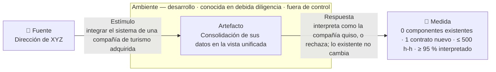
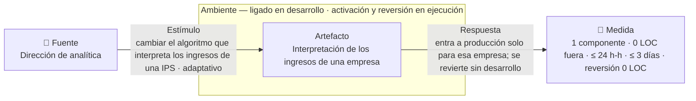

# Escenarios de calidad — interoperabilidad y modificabilidad

Esta página fija los dos requisitos de calidad significativos para la
arquitectura (ASR) del reto 3: uno de interoperabilidad, ASR-I01, y uno de
modificabilidad, ASR-M01. Son el escenario de cada atributo que el curso pide
priorizar y validar con juicio de expertos (R-9 en
[restricciones](constraints.md)).

**De dónde sale.** La v1 de Carlos Chaparro priorizó ASR-I01 y ASR-M01. La v2,
que es la que esta página publica, conserva los dos identificadores, su
intención y su experimento. Los reescribe en el espacio del problema: sin
componentes ni tácticas dentro del requisito, con el ambiente en la forma de
cada atributo y con el origen de cada cifra.

**Las cifras.** El enunciado no trae cifras de esfuerzo, tiempo ni porcentaje.
Solo cuenta ocho empresas [Ctx] y siete dominios de datos [Reto-1]. Toda otra
cifra es un supuesto `S-n` con su destinatario, en la sección 2.

{: .importante }
> Las ideas de solución quedan fuera de las seis partes. Un mecanismo concreto
> —un adaptador, un modelo canónico, un catálogo de reglas, un bus— es una
> hipótesis que las [decisiones de arquitectura](modelos/adrs.md) confirmarán o
> cambiarán. En la ficha no entra.

Esta es la primera página del recorrido que puede nombrar los identificadores de
escenario. Las cinco páginas de insumo no lo hacen, porque son la materia con la
que estos escenarios se construyen. El vocabulario está fijado en el
[glosario](glossary.md).

## 1. Los ASR

| ID | Atributo · tipo | Enunciado corto | Ambiente | Prioridad | Impacto | Origen |
|---|---|---|---|---|---|---|
| ASR-I01 | Interoperabilidad · socio fuera de control | Integrar una compañía de turismo adquirida no modifica ningún componente existente, suma 1 contrato de integración, cuesta ≤ 500 h-h e interpreta ≥ 95 % de su lote | Desarrollo · conocida en la debida diligencia · tercero fuera de control | Alta | Alto | `enunciado` · R-3, R-7 |
| ASR-M01 | Modificabilidad · adaptativo | Cambiar el algoritmo que interpreta los ingresos de una empresa toca 1 componente, 0 LOC de legado fuera de él, cuesta ≤ 24 h-h y se revierte sin desarrollo | Desarrollo (el algoritmo) · ejecución (activarlo y revertirlo) | Alta | Alto | `enunciado` · R-4 |

El tipo dice qué parte del atributo cubre el escenario. En modificabilidad es la
clase de cambio: correctivo, preventivo, adaptativo o aditivo. En
interoperabilidad es el grado de control sobre el socio que se integra.

## 1b. De qué historia cuelga cada escenario

Un escenario de calidad no vive solo: se ata a la historia de usuario cuyo actor
lo sufre o lo recibe. Esa historia aporta la fuente, el estímulo y la respuesta;
la ficha de abajo aporta el ambiente y la medida.

| ASR | Historia | Actor | Por qué esa y no otra |
|---|---|---|---|
| ASR-I01 | [HU-03](requirements.md) — Integrar una compañía de turismo adquirida | Dirección de XYZ | Es la integración con más distancia: otro sector, otro proveedor, un sistema que no se modifica y datos que hay que reinterpretar, como una reserva cancelada |
| ASR-M01 | [HU-07](requirements.md) — Cambiar el algoritmo de ingresos de una empresa | Dirección de analítica | Es el cambio que el enunciado declara frecuente [Reto-2], y el único que pide además poder volver atrás |

Las demás historias no cargan escenario propio en esta iteración, por tres
razones distintas.

- **Misma forma, menos distancia.** HU-04 (compañía de salud) y HU-06 (sistema
  de reemplazo) recorren el mismo camino que HU-03 con un socio más cercano.
  ASR-I01 ya fija su medida.
- **Misma decisión.** HU-05 (una empresa cambia su sistema) la contiene la
  misma frontera que exige ASR-I01. HU-08 (corregir una regla y su histórico) la
  contiene la misma decisión que ASR-M01.
- **No priorizadas o de otro atributo.** HU-13 (presentación de informes) quedó
  como candidata. HU-01, HU-02 y HU-09 a HU-12 son funcionales, o su calidad es
  de desempeño, fuera del alcance (ver [problema](architecture.md)).

## 2. Ambientes

Los ambientes de estos dos atributos no son de carga. En modificabilidad, el
ambiente es el **momento de ligado**: cuándo queda fijo lo que cambia. En
interoperabilidad, es la **fase** en que se mide y el **grado de control** sobre
el socio.

### Modificabilidad · momento de ligado

| Ligado | Qué entra así | ASR |
|---|---|---|
| Desarrollo | El algoritmo nuevo de interpretación: es código | ASR-M01 |
| Ejecución | Activar el algoritmo nuevo para una empresa y volver al anterior, sin redesplegar | ASR-M01 |

### Modificabilidad · un cambio probable por tipo

| Tipo | Cambio probable | Ligado | ASR o descarte |
|---|---|---|---|
| Correctivo | Una regla de interpretación se aplicó mal y hay que corregirla con su histórico (HU-08) | Desarrollo | Descartado en esta iteración: lo contiene la misma decisión que ASR-M01 |
| Preventivo | Un indicador, como «ingreso neto», se calcula distinto en varios análisis [Ctx: los cambios cuestan «más de lo esperado»] | Desarrollo | Descartado en esta iteración: no fue priorizado; candidato para la siguiente |
| Adaptativo | Cambia el algoritmo con que se interpretan los datos de una empresa [Reto-2] (HU-07) | Desarrollo · ejecución | **ASR-M01** |
| Adaptativo | Una empresa cambia su sistema y eso impacta la lógica de la holding [Reto-2] (HU-05) | Desarrollo | Descartado en esta iteración (ASR-M02 de la v1): lo contiene la misma frontera que exige ASR-I01 |
| Aditivo | Cambia la presentación de los informes para directivos [Reto-2] (HU-13) | Despliegue | Descartado en esta iteración: el curso pide un escenario por atributo, y la v1 lo dejó fuera por menor impacto estructural |

### Interoperabilidad · socios

La fase es **desarrollo**: la integración se mide mientras se construye, no
cuando opera (clase del 13/10, [15:05]). Quien pide integrar es la holding; el
socio es el otro lado.

| Socio | Cómo se le conoce | Grado de control |
|---|---|---|
| Compañía de turismo adquirida [Reto-1] | En la debida diligencia, antes de integrarla | Tercero fuera de control: su sistema está en producción, es de otro proveedor y no se puede modificar (S-2) |
| Compañía de salud adquirida [Reto-1] | En la debida diligencia | Tercero fuera de control |
| Empresas actuales del grupo [Ctx] | De antemano | Tercero bajo control: la holding manda sobre la empresa, no sobre el producto de su proveedor (S-1) |
| Sistema de reemplazo de una empresa, como un ERP o un callcenter nuevo [Reto-1] | De antemano | Tercero fuera de control |

### Equivalente en TPS

Helix pide un número de transacciones por segundo en cada escenario. Los dos se
cargan con **TPS = 0**, y no por omisión: los dos se miden en desarrollo, sobre
el esfuerzo y la propagación del cambio, y no sobre una carga en operación.

### Supuestos que fijan las cifras

El enunciado no trae cifras de esfuerzo ni de proporción. Esta tabla las fija
para que los escenarios se puedan medir, y cada supuesto dice de dónde sale y
qué pasa si resulta falso, para que el negocio lo pueda corregir sin rehacer el
análisis.

La numeración continúa la de [restricciones](constraints.md), que tiene S-1 a
S-5. La última columna da la hipótesis equivalente de la v2, para quien la
compare.

| # | Supuesto | A quién | Por qué es razonable | Si resulta falso | v2 |
|---|---|---|---|---|---|
| S-6 | Los cambios los hace un equipo propio de 2 desarrolladores, con 8 h por día hábil y 22 días hábiles al mes | Dirección de tecnología | Es la escala mínima para absorber cambios frecuentes sin depender de cada empresa | Si son terceros nuevos en el sistema, las h-h de ASR-I01 y ASR-M01 suben | H-01 |
| S-7 | Integrar la compañía de turismo cuesta ≤ 500 h-h; con 2 personas son unos 31 días hábiles, cerca de 6 semanas | Dirección de estrategia | Es la cifra que la clase usó para esta misma holding con las agencias de viajes que compra (clase del 13/10, [09:48–10:57]). La v1 proponía 80 h-h, dos semanas de una persona: poco creíble para cinco dominios de un sistema de otro sector | Si el negocio exige menos, el umbral baja a costa de supuestos sobre la interfaz del socio | H-02 |
| S-8 | Del lote de la compañía de turismo se interpreta ≥ 95 %; el 5 % restante se rechaza con diagnóstico | Dirección financiera | Es la pérdida aceptable que la clase planteó para las agencias ([15:14–15:46]) | Si consolidar ingresos exige más, se sube solo para ingresos y egresos | H-03 |
| S-9 | Un cambio de algoritmo toca 1 componente y 0 LOC de legado fuera de él | Dirección de tecnología | «Frecuentes» sugiere al menos 2 cambios al mes; si cada uno se riega, el equipo vive en regresiones | Si los cambios son raros, ASR-M01 baja a prioridad media | H-05 |
| S-10 | Un algoritmo nuevo está en producción en ≤ 3 días hábiles y ≤ 24 h-h desde la solicitud | Dirección de analítica | Es la cifra de la v1. Cabe en una semana de trabajo y permite ajustar antes del cierre mensual; las 24 h-h son 3 días × 8 h de una persona | Si el negocio acepta un ciclo mensual, el umbral sube y ASR-M01 pierde fuerza | H-06 |
| S-11 | Revertir un algoritmo cuesta 0 LOC y ≤ 1 h-h | Dirección de analítica | Revertir no debería pedir un ciclo de desarrollo | Si revertir exige código, la activación también: el cambio se liga en desarrollo y ASR-M01 se reescribe | H-07 |

La hipótesis H-04 de la v2, que las reservas caben en los siete dominios, no
fija una cifra y vive en restricciones como S-3.

## 2b. Matriz de análisis

### Matriz de distancias de interoperabilidad

Las cinco distancias son las del capítulo 18.1. Cada celda lleva el ASR que la
cierra o la razón de su descarte, para que la omisión sea una decisión y no un
olvido.

| Socio · control | Sintáctica | Semántica en datos | Semántica en comportamiento | Temporal | De recursos |
|---|---|---|---|---|---|
| Compañía de turismo · fuera de control | **ASR-I01**: su propia interfaz y sus campos | **ASR-I01**: moneda, códigos de cliente, reserva frente a venta | **ASR-I01**: una reserva se cancela y se reembolsa, y la venta se revierte | Descartada: `[PREGUNTA → dirección de tecnología]` ¿en qué ventanas puede entregar datos? No se sabe hasta la debida diligencia | Descartada: misma razón |
| Compañía de salud · fuera de control | Descartada: misma forma que ASR-I01 con menor distancia; ASR-I01 es el caso exigente | Descartada: misma razón | Descartada: misma razón | Descartada: misma razón | Descartada: misma razón |
| Empresas actuales · bajo control | Descartada en esta iteración (ASR-I02 de la v1) | Descartada en esta iteración: candidata para la siguiente (ASR-I02 de la v1, sin su p95) | Descartada en esta iteración: los estados de contratos y pólizas quedan como candidatos | Descartada: la ventana la pacta la holding con su propia empresa | Descartada: misma razón |
| Sistema de reemplazo · fuera de control | Descartada en esta iteración: misma forma que ASR-I01 | Descartada: misma razón | Descartada: misma razón | Descartada: la ventana no la fija el producto | Descartada: misma razón |

### Puntos de cambio de modificabilidad

La matriz de modificabilidad es la tabla de cambios por tipo de la sección 2:
un cambio probable por tipo, con su ligado y su resultado.

## 3. Fichas

Una ficha por ASR. Las seis partes son fuente, estímulo, artefacto, ambiente,
respuesta y medida; las filas siguientes dicen de dónde sale cada cifra, quién
hace el cambio, por qué el escenario es arquitectónico y cómo se verifica.

{: .nota }
> Helix no carga las seis partes: deriva `Source`, `Stimulus` y `Response` de la
> narrativa de la historia, y solo pide atributo, prioridad, artefacto,
> ambiente, TPS y medida, esta última con deslizadores fijos. Las medidas de
> estos dos escenarios no son de tiempo de respuesta y viven completas solo en
> esta página. El detalle está en `notas/helix-recorrido-funcional.md`.

### ASR-I01 — Integrar una compañía de turismo adquirida

| | |
|---|---|
| **Fuente** | La dirección de XYZ, tras adquirir una compañía de turismo [Reto-1] |
| **Estímulo** | Integrar el sistema de reservas y facturación de la compañía: está en producción, es de otro proveedor y usa sus propios campos, códigos de cliente y moneda |
| **Artefacto** | La consolidación de los datos de la compañía en la vista unificada de la holding: clientes, ventas, ingresos, egresos y productos adquiridos |
| **Ambiente** | Desarrollo · socio conocido en la debida diligencia · tercero fuera de control: su sistema no se puede modificar |
| **Respuesta** | La compañía queda integrada: sus datos se interpretan con el significado que ella les dio, o se rechazan con diagnóstico. Lo que ya funciona para las 8 empresas del grupo no cambia |
| **Medida** | **Principal:** 0 componentes existentes modificados o redesplegados, y 1 contrato de integración nuevo. **Pareja:** ≤ 500 h-h desde la solicitud hasta que los datos de la compañía quedan en la vista unificada. **Interpretación:** del lote de muestra, ≥ 95 % de los registros interpretados; el resto se rechaza con diagnóstico y 0 se registran con otro significado |
| **De dónde sale el número** | Las 500 h-h (S-7) y el 95 % (S-8) son supuestos, por analogía con el ejemplo que la clase usó para esta misma holding: las agencias de viajes que compra, en menos de 500 horas y con un 5 % de pérdida aceptable (clase del 13/10, [09:48–10:57] y [15:14–15:46]). El 0 y el 1 son `[SUPUESTO → dirección de tecnología]`: el motivador, más adquisiciones por venir, justifica medir la propagación, no el número. **Base:** inventario de los campos del sistema de turismo × su distancia, recorrido sobre los 7 dominios. **Denominador:** los registros de un mes de reservas y facturación de la compañía. **Interpretado:** moneda, código de cliente y estado de la reserva quedan con el significado de la compañía, contra un lote de referencia que firma la dirección financiera de la holding; el porcentaje sintáctico se cuenta aparte. **Distancias que cierra:** sintáctica, semántica en datos y semántica en comportamiento |
| **Quién lo hace** | Equipo propio de la holding, que conoce la vista unificada y no conoce el sistema de la compañía (S-4, S-6) |
| **Por qué es ASR** | «0 existentes y 1 contrato» obliga a decidir si cada compañía nueva se conecta a un contrato común o si obliga a tocar lo que ya funciona; con N compañías, la diferencia es sumar un contrato o sumar N cambios. En contra: «la adquisición no tiene fecha». Pierde porque el enunciado la pone como razón de ser de la arquitectura |
| **Cómo se verifica** | Juicio de expertos con el protocolo de esta página (escenarios E-I). Complemento, el experimento E1 de la v1: sobre el cambio ensayado, contar los componentes nuevos y los modificados en el diff, comparar que los artefactos desplegados antes y después sean idénticos, sumar las h-h registradas y medir el porcentaje interpretado del lote |
| **Prioridad · Impacto · Origen** | Alta · Alto · `enunciado` |

#### Matriz de análisis del escenario

| Socio · control | Distancia | Stakeholder (aux.) | Fase | Resultado |
|---|---|---|---|---|
| Compañía de turismo · fuera de control | Sintáctica · semántica en datos · semántica en comportamiento | Dirección de XYZ · dirección financiera | Desarrollo | **Este escenario** |
| Compañía de turismo · fuera de control | Temporal · de recursos | Dirección de tecnología | Desarrollo | Descartada: se conoce solo en la debida diligencia |
| Compañía de salud · fuera de control | Las cinco | Dirección de estrategia | Desarrollo | Descartada: misma forma con menor distancia |

### ASR-M01 — Cambiar el algoritmo que interpreta los ingresos de una empresa

| | |
|---|---|
| **Fuente** | La dirección de analítica de la holding |
| **Estímulo** | Cambiar el algoritmo con que se interpretan los ingresos de una IPS: hoy se toma lo facturado, y la holding decide tomar lo facturado menos lo glosado. Cambio frecuente [Reto-2] · tipo adaptativo |
| **Artefacto** | La interpretación de los ingresos de una empresa del grupo |
| **Ambiente** | Ligado en desarrollo para el algoritmo nuevo, que es código; su activación para una empresa y su reversión se ligan en ejecución, sin redesplegar |
| **Respuesta** | El algoritmo nuevo se implementa, se prueba y entra a producción solo para esa empresa. Las interpretaciones de las otras 7 no cambian. Volver al algoritmo anterior no requiere desarrollo |
| **Medida** | **Principal:** 1 componente nuevo o modificado. **Pareja:** 0 LOC de legado tocadas fuera de él. **Costo:** ≤ 24 h-h y ≤ 3 días hábiles desde la solicitud hasta producción. **Reversión:** 0 LOC y ≤ 1 h-h |
| **De dónde sale el número** | Las 7 salen del enunciado: 8 empresas menos la que cambia [Ctx]. Los 3 días son de la v1 y las 24 h-h son la cuenta que los hace cuadrar con una persona, 3 días × 8 h (S-10). El 1 componente y las 0 LOC (S-9) y la reversión en ≤ 1 h-h (S-11) son supuestos. Que el enunciado llame «frecuentes» a estos cambios justifica medir la propagación, no el número. **Base:** recorrido del cambio sobre la descomposición funcional |
| **Quién lo hace** | Equipo propio de analítica, que conoce la interpretación de esa empresa `[SUPUESTO → dirección de analítica]` |
| **Por qué es ASR** | Obliga a decidir dónde vive cada algoritmo y si su elección es código o dato; si cambiara una vez al año, aislarlo sería sobreingeniería. En contra: «es un cambio de código como cualquier otro». Pierde porque el enunciado lo declara frecuente [Reto-2] y caro hoy [Ctx] |
| **Cómo se verifica** | Juicio de expertos con el protocolo de esta página (escenarios E-M). Complemento, el experimento E2 de la v1, repetido con tres cambios de algoritmo: sobre cada diff, contar componentes nuevos y modificados y LOC fuera del nuevo; sumar h-h y días; y en la reversión, contar LOC y h-h |
| **Prioridad · Impacto · Origen** | Alta · Alto · `enunciado` |

#### Matriz de análisis del escenario

| Tipo de cambio | Cambio probable | Stakeholder (aux.) | Ligado | Resultado |
|---|---|---|---|---|
| Adaptativo | Cambiar el algoritmo de ingresos de una IPS | Dirección de analítica | Desarrollo · ejecución | **Este escenario** |
| Correctivo | Corregir una regla mal aplicada y su histórico | Dirección de analítica | Desarrollo | Descartada: misma decisión |
| Adaptativo | Una empresa cambia su sistema | Dirección de tecnología | Desarrollo | Descartada: la contiene la frontera de ASR-I01 |

### Protocolo de verificación

| | |
|---|---|
| **Panel** | ≥ 2 humanos de fuera del curso: un arquitecto de integración con experiencia en salud y un líder de analítica de una aseguradora. Un evaluador no humano, si se usa, va en columna aparte. `[PREGUNTA → equipo del curso]` ¿Quiénes son? |
| **Presentación** | Los dos ASR, la arquitectura y sus decisiones principales, sin elogiar las tácticas y sin mostrar los umbrales |
| **Escala** | 1 muy improbable · 2 improbable · 3 ni una ni otra · 4 probable · 5 muy probable |
| **Escenarios** | **E-M (ASR-M01):** cambiar el algoritmo de ingresos de una IPS tocando 1 componente y 0 LOC fuera de él, en 12 · **24** · 36 · 72 h-h (×0,5 · ×1 · ×1,5 · ×3; el real, segundo). **E-I (ASR-I01):** integrar la compañía de turismo sin modificar componentes existentes, en 150 · 300 · **500** · 1 000 h-h (×0,3 · ×0,6 · ×1 · ×2; el real, tercero). **Control negativo:** reemplazar la tecnología que guarda los datos unificados tocando 1 componente en 24 h-h. El formulario mezcla los nueve en orden aleatorio, y el real, en negrita aquí, no se señala en la encuesta |
| **Tabulación** | Una columna por experto (A, B, C), con mediana y rango de los humanos |
| **Regla de decisión** | Escrita antes de encuestar. **Sostenido:** mediana ≥ 4 y ningún humano ≤ 2. **Refutado:** mediana ≤ 2. **No concluyente:** cualquier otro caso. Si el control negativo saca 4 o 5, el panel aceptó todo y el resultado se anula |

## 4. Descartes

Criterios de la columna «Salió por».

| Criterio | Qué significa |
|---|---|
| 10× | Multiplicar o dividir la cifra por diez no cambia la estructura |
| Elemento tocado | No decide nada que otro ASR no decida ya |
| Palanca | No la mueve una decisión de software |
| Neutralidad | Solo se sostiene con una solución ya elegida |
| Medida | La forma de medir no sirve para diseñar |
| Fuera de alcance | Es de otro atributo |

| Candidato | Origen | Salió por | Razón | Va a |
|---|---|---|---|---|
| ASR-I02 v1: p95 ≤ 5 min desde la fuente hasta la vista unificada | `enunciado` | Fuera de alcance | Mide la frescura del dato: es desempeño | Otro atributo |
| ASR-I02 v1: 100 % del oráculo interpretado | `enunciado` | Medida | El 100 % no se justifica y el curso no lo espera ([15:46]); su parte semántica pasó a la medida de ASR-I01 | ASR-I01 |
| ASR-M02 v1: un cambio en el sistema de una empresa solo toca lo de esa empresa | `enunciado` | Elemento tocado | Lo contiene la misma decisión de frontera que ASR-I01; candidato para la siguiente iteración | — |
| Cambios frecuentes en la presentación de informes | `enunciado` | Elemento tocado | El curso pide un escenario por atributo; la v1 lo dejó fuera por menor impacto estructural | Candidato |
| Reversión del algoritmo en ≤ 5 minutos (v1) | `lente: ambiente` | Fuera de alcance | Minutos de restablecimiento son una medida de ejecución: es disponibilidad. Lo de modificabilidad quedó en ASR-M01: revertir cuesta 0 LOC | Otro atributo |
| Algoritmo de propensión de venta cruzada como estímulo de ASR-M01 (v1) | `enunciado` | Neutralidad | El enunciado habla de los algoritmos que interpretan los datos de las empresas, no de los modelos de analítica; se reemplazó por la interpretación de ingresos | ASR-M01 |
| Tiempo a producción como media (v1) | `lente: inversión` | Medida | Una media con una sola muestra no dice nada; en modificabilidad la medida es una estimación con su umbral | ASR-M01 |
| Corregir una regla mal aplicada y su histórico | `lente: inversión` | Elemento tocado | Lo contiene la misma decisión que ASR-M01 | — |
| Unificar la definición de un indicador | `lente: segundo orden` | Elemento tocado | No priorizado en esta iteración | Candidato |
| Integrar una compañía de salud o un sistema de reemplazo | `enunciado` | 10× | Misma forma que ASR-I01 con menor distancia | ASR-I01 |
| La exactitud con que se reconoce al mismo cliente en varias empresas | `lente: segundo orden` | Palanca | Ninguna estructura mueve la exactitud de un algoritmo; lo arquitectónico es poder cambiarlo (ASR-M01) | Funcional |

## 5. Lo que queda abierto

### Riesgos de alcanzabilidad

- **ASR-I01.** Si las reservas no caben en los siete dominios (S-3), integrar
  turismo modifica el modelo común y el «0 componentes existentes» falla. Hay
  dos salidas: aceptar que el modelo crezca sin romper a quienes ya lo usan, y
  medir eso, o cambiar el estímulo a una compañía de salud.
- **ASR-I01.** Las 80 h-h de la v1 son 6 veces menos que la analogía de la
  clase. Si el equipo las mantiene, que sea con la razón escrita.

### Fuera de alcance

- **Desempeño:** la frescura del dato unificado, el p95 ≤ 5 min de la v1.
- **Disponibilidad:** revertir un algoritmo en minutos; integrar o reemplazar
  sin interrumpir el servicio.
- **Funcional:** la exactitud del reconocimiento de clientes entre empresas.

### Preguntas para el negocio

Todas las cifras de diseño son supuestos con destinatario (S-6 a S-11). Las
únicas cifras del enunciado son las 8 empresas y los 7 dominios. Las preguntas
que las confirmarían están en
[restricciones cuantitativas pendientes](constraints.md#restricciones-cuantitativas-pendientes).
