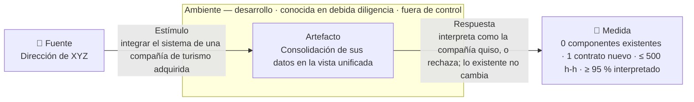
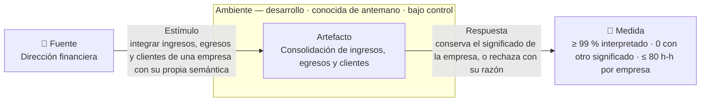
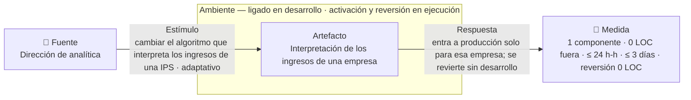
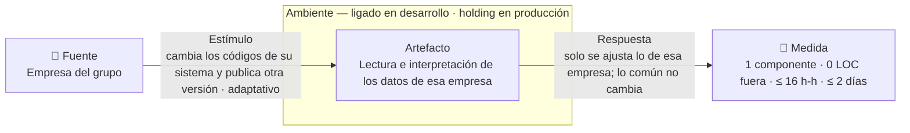

# Escenarios de calidad — interoperabilidad y modificabilidad

Esta página fija los cuatro requisitos de calidad significativos para la
arquitectura (ASR) del sistema que integra los datos de la holding XYZ. Dos son
de interoperabilidad: integrar una compañía adquirida e interpretar bien los
datos de las empresas actuales. Dos son de modificabilidad: cambiar un algoritmo
de interpretación y absorber el cambio de una empresa en su propio sistema.

El curso pide validar con juicio de expertos un escenario de cada atributo (R-9
en [restricciones](constraints.md)). Los dos que van a esa validación son
ASR-I01 y ASR-M01; los otros dos se verifican con un experimento.

El enunciado no trae cifras de esfuerzo, tiempo ni porcentaje. Solo cuenta ocho
empresas y siete dominios de datos, así que toda otra cifra es un supuesto
`S-n` con su destinatario, en la sección 2.

{: .importante }
> Las ideas de solución quedan fuera de las seis partes. Un adaptador, un modelo
> canónico, un catálogo de reglas o un bus son hipótesis que las
> [decisiones de arquitectura](modelos/adrs.md) confirmarán o cambiarán. En la
> ficha no entran.

Es la primera página del recorrido que nombra los identificadores de escenario.
Las cinco páginas de insumo no lo hacen, porque son la materia con la que estos
escenarios se construyen. El vocabulario está fijado en el
[glosario](glossary.md).

## 1. Los ASR

| ID | Atributo · tipo | Enunciado corto | Ambiente | Prioridad | Impacto | Origen |
|---|---|---|---|---|---|---|
| ASR-I01 | Interoperabilidad · socio fuera de control | Integrar una compañía de turismo adquirida no modifica ningún componente existente, suma 1 contrato de integración, cuesta ≤ 500 h-h e interpreta ≥ 95 % de su lote | Desarrollo · conocida en la debida diligencia · tercero fuera de control | Alta | Alto | Enunciado · R-3, R-7 |
| ASR-I02 | Interoperabilidad · socio bajo control | Integrar los ingresos, egresos y clientes de una empresa del grupo interpreta ≥ 99 % de su lote, registra 0 con otro significado y cuesta ≤ 80 h-h por empresa | Desarrollo · conocida de antemano · tercero bajo control | Alta | Medio | Enunciado · R-2, R-6 |
| ASR-M01 | Modificabilidad · adaptativo | Cambiar el algoritmo que interpreta los ingresos de una empresa toca 1 componente y 0 LOC de legado fuera de él, cuesta ≤ 24 h-h y se revierte sin desarrollo | Desarrollo (el algoritmo) · ejecución (activarlo y revertirlo) | Alta | Alto | Enunciado |
| ASR-M02 | Modificabilidad · adaptativo | Absorber el cambio de una empresa en su propio sistema toca 1 componente y 0 LOC fuera de él, y cuesta ≤ 16 h-h | Desarrollo | Alta | Medio | Enunciado · R-4 |

La columna de tipo dice qué parte del atributo cubre el escenario. En
modificabilidad es la clase de cambio: correctivo, preventivo, adaptativo o
aditivo. En interoperabilidad es el grado de control que la holding tiene sobre
el socio que integra.

La prioridad mide la importancia para el negocio, y el impacto la dificultad de
lograrlo. ASR-I02 y ASR-M02 tienen impacto medio porque buena parte de lo que
exigen ya lo fuerzan ASR-I01 y ASR-M01.

## 1b. De qué historia cuelga cada escenario

Cada escenario se ata a la historia de usuario cuyo actor lo sufre o lo recibe.
La historia aporta la fuente, el estímulo y la respuesta, y la ficha de abajo
aporta el ambiente y la medida.

| ASR | Historia | Actor | Por qué esa y no otra |
|---|---|---|---|
| ASR-I01 | [HU-03](requirements.md) — Integrar una compañía de turismo adquirida | Dirección de XYZ | Es la integración con más distancia: otro sector, otro proveedor, un sistema que no se modifica y datos que hay que reinterpretar, como una reserva cancelada |
| ASR-I02 | [HU-10](requirements.md) — Ingresos y egresos unificados | Dirección financiera | Es quien suma cifras de las ocho empresas, y quien sufre el error que nadie ve: un monto en centavos que entra como pesos |
| ASR-M01 | [HU-07](requirements.md) — Cambiar el algoritmo de ingresos de una empresa | Dirección de analítica | Es el cambio que el enunciado anuncia como frecuente, y el único que además pide volver atrás |
| ASR-M02 | [HU-05](requirements.md) — Cambio en el sistema de una empresa | Dirección de tecnología | Es el único cambio que no decide la holding: lo decide la empresa, y llega sin pedir permiso |

Las demás historias no cargan escenario propio, por una de tres razones.

- **Misma forma con menos distancia.** HU-04 (compañía de salud) y HU-06
  (sistema de reemplazo) recorren el camino de HU-03 con un socio más cercano, y
  ASR-I01 ya fija su medida.
- **Misma decisión de diseño.** HU-08, que corrige una regla y su histórico, la
  resuelve la misma decisión que exige ASR-M01. HU-09, que muestra los
  registros rechazados, depende del rechazo con diagnóstico que ya exigen
  ASR-I01 y ASR-I02.
- **No priorizadas o de otro atributo.** HU-13, sobre la presentación de
  informes, quedó como candidata. HU-01, HU-02, HU-11 y HU-12 son funcionales, o
  su calidad es de desempeño y está fuera del alcance (ver
  [problema](architecture.md)).

## 2. Ambientes

Ninguno de los dos atributos tiene un ambiente de carga. En modificabilidad, el
ambiente es el **momento de ligado**, es decir, cuándo queda fijo lo que cambia.
En interoperabilidad, son la **fase** en que se mide y el **grado de control**
sobre el socio.

### Modificabilidad · momento de ligado

| Ligado | Qué se liga en ese momento | ASR |
|---|---|---|
| Desarrollo | El algoritmo nuevo de interpretación, que es código | ASR-M01 |
| Desarrollo | La adaptación a lo que una empresa cambió en su sistema | ASR-M02 |
| Ejecución | Activar el algoritmo nuevo para una empresa, y volver al anterior, sin redesplegar | ASR-M01 |

### Modificabilidad · un cambio probable por tipo

| Tipo | Cambio probable | Ligado | ASR o descarte |
|---|---|---|---|
| Correctivo | Corregir una regla de interpretación mal aplicada, con su histórico (HU-08) | Desarrollo | Descartado: lo resuelve la misma decisión que ASR-M01 |
| Preventivo | Unificar un indicador, como el ingreso neto, que hoy se calcula distinto en varios análisis | Desarrollo | Descartado en esta iteración: no fue priorizado y queda como candidato |
| Adaptativo | Cambiar el algoritmo que interpreta los datos de una empresa (HU-07) | Desarrollo · ejecución | **ASR-M01** |
| Adaptativo | Absorber el cambio de una empresa en su propio sistema (HU-05) | Desarrollo | **ASR-M02** |
| Aditivo | Cambiar la presentación de los informes para directivos (HU-13) | Despliegue | Descartado en esta iteración: tiene menor impacto estructural que los dos adaptativos |

### Interoperabilidad · socios

La fase es **desarrollo**: la integración se mide mientras se construye y no
cuando opera. Quien pide integrar es la holding, y el socio es el sistema del
otro lado.

| Socio | Cuándo lo conoce la holding | Grado de control |
|---|---|---|
| Compañía de turismo adquirida | En la debida diligencia, antes de integrarla | Tercero fuera de control: su sistema está en producción, es de otro proveedor y no se modifica (S-2) |
| Compañía de salud adquirida | En la debida diligencia | Tercero fuera de control |
| Empresas actuales del grupo | De antemano | Tercero bajo control: la holding manda sobre la empresa, no sobre el producto de su proveedor (S-1) |
| Sistema de reemplazo de una empresa, como un ERP o un callcenter nuevo | De antemano | Tercero fuera de control |

### Equivalente en TPS

Helix pide un número de transacciones por segundo en cada escenario. Los cuatro
se cargan con **TPS = 0**, porque se miden en desarrollo, sobre el esfuerzo y la
propagación del cambio, y no sobre una carga en operación.

### Supuestos que fijan las cifras

Cada supuesto dice a quién le corresponde confirmarlo, por qué es razonable y
qué pasa con el escenario si resulta falso. La numeración continúa la de
[restricciones](constraints.md), que llega hasta S-5.

| # | Supuesto | A quién | Por qué es razonable | Si resulta falso |
|---|---|---|---|---|
| S-6 | Los cambios los hace un equipo propio de 2 desarrolladores, con 8 h por día hábil y 22 días hábiles al mes | Dirección de tecnología | Es la escala mínima para absorber cambios frecuentes sin depender de cada empresa | Si los hacen terceros nuevos en el sistema, las h-h de los cuatro escenarios suben |
| S-7 | Integrar la compañía de turismo cuesta ≤ 500 h-h, que con 2 personas son unos 31 días hábiles | Dirección de estrategia | Es la cifra que la clase usó para esta misma holding al integrar las agencias de viajes que compra. Alcanza para recorrer cinco dominios de un sistema de otro sector | Si el negocio exige menos, el umbral baja, a costa de suponer más sobre la interfaz del socio |
| S-8 | Del lote de la compañía de turismo se interpreta ≥ 95 %, y el resto se rechaza con diagnóstico | Dirección financiera | Es la pérdida aceptable que la misma clase planteó para las agencias | Si consolidar ingresos exige más, se sube el umbral solo para ingresos y egresos |
| S-9 | Un cambio de algoritmo toca 1 componente y 0 LOC de legado fuera de él | Dirección de tecnología | Si «frecuentes» significa al menos dos cambios al mes y cada uno se riega por el sistema, el equipo vive en regresiones | Si los cambios son raros, ASR-M01 baja a prioridad media |
| S-10 | Un algoritmo nuevo llega a producción en ≤ 3 días hábiles y ≤ 24 h-h desde la solicitud | Dirección de analítica | Tres días caben en una semana de trabajo y dejan margen antes del cierre mensual. Las 24 h-h son esos 3 días a 8 h de una persona | Si el negocio acepta un ciclo mensual, el umbral sube y ASR-M01 pierde fuerza |
| S-11 | Revertir un algoritmo cuesta 0 LOC y ≤ 1 h-h | Dirección de analítica | Volver al algoritmo anterior no debería pedir un ciclo de desarrollo | Si revertir exige código, activar también lo exige: el cambio se liga en desarrollo y ASR-M01 se reescribe |
| S-12 | Del lote de una empresa del grupo se interpreta ≥ 99 %, y 0 registros entran con otro significado | Dirección financiera | La holding manda sobre sus empresas y puede pedirles corregir en la fuente, así que tolera menos pérdida que con una compañía recién comprada | Si la dirección financiera exige el 100 %, el rechazo deja de ser excepción y pasa a ser un proceso de la operación |
| S-13 | Integrar los tres dominios de una empresa del grupo cuesta ≤ 80 h-h, dos semanas de una persona | Dirección de tecnología | La empresa es del mismo sector, su sistema se conoce y la holding puede pedirle documentación | Las ocho empresas suman 640 h-h, casi dos meses del equipo de S-6. Si cada una cuesta más, integrar el grupo completo ocupa al equipo un trimestre o más |
| S-14 | Absorber el cambio de una empresa en su sistema toca 1 componente y 0 LOC fuera de él | Dirección de tecnología | El cambio es de una sola empresa; si toca lo que leen las otras siete o los informes, cada actualización de un proveedor se vuelve un proyecto de la holding | Si el cambio obliga a tocar el significado común de un dominio, la medida pasa a contar cuántos lectores de ese dominio se rompen |
| S-15 | Absorber ese cambio cuesta ≤ 16 h-h y ≤ 2 días hábiles desde que la empresa lo anuncia | Dirección de tecnología | Dos días de una persona dejan los datos de la empresa al día antes de que el atraso se note en la consolidación mensual | Si la empresa no avisa antes de cambiar, el plazo corre desde que se detecta el rechazo, y hay que medir también cuánto tarda en detectarse |

El supuesto de que las reservas de turismo caben en los siete dominios no fija
una cifra, y por eso está en restricciones como S-3.

## 2b. Matriz de análisis

### Distancias de interoperabilidad

Las cinco distancias son las del capítulo 18.1 del libro de referencia del curso
(`[PREGUNTA]` título y edición). Cada celda dice qué ASR la cierra o por qué se
descartó, para que ninguna omisión sea un olvido.

| Socio · control | Sintáctica | Semántica en datos | Semántica en comportamiento | Temporal | De recursos |
|---|---|---|---|---|---|
| Compañía de turismo · fuera de control | **ASR-I01**: su propia interfaz y sus campos | **ASR-I01**: moneda, códigos de cliente, reserva frente a venta | **ASR-I01**: una reserva cancelada y reembolsada revierte la venta | Descartada: no se sabe en qué ventanas entrega datos hasta la debida diligencia. `[PREGUNTA → dirección de tecnología]` | Descartada por la misma razón |
| Compañía de salud · fuera de control | Descartada: misma forma que ASR-I01 con menos distancia | Descartada por la misma razón | Descartada por la misma razón | Descartada por la misma razón | Descartada por la misma razón |
| Empresas actuales · bajo control | **ASR-I02**: cada empresa entrega en su propio formato de montos, fechas y documentos | **ASR-I02**: unidades de los montos, tipos de documento, códigos de estado | Descartada en esta iteración: los estados de contratos y pólizas quedan como candidatos | Descartada: la ventana la pacta la holding con su propia empresa | Descartada por la misma razón |
| Sistema de reemplazo · fuera de control | Descartada: misma forma que ASR-I01 | Descartada por la misma razón | Descartada por la misma razón | Descartada: la ventana no la fija el producto | Descartada por la misma razón |

### Puntos de cambio de modificabilidad

La matriz de modificabilidad es la tabla de cambios por tipo de la sección 2: un
cambio probable por tipo, con su ligado y su resultado.

## 3. Fichas

Las seis partes de cada ficha son fuente, estímulo, artefacto, ambiente,
respuesta y medida. Las filas siguientes dicen de dónde sale cada cifra, quién
hace el cambio, por qué el escenario es arquitectónico y cómo se verifica.

{: .nota }
> Helix no carga las seis partes. Deriva `Source`, `Stimulus` y `Response` de la
> narrativa de la historia, y solo pide atributo, prioridad, artefacto,
> ambiente, TPS y medida, esta última con deslizadores fijos. Ninguna medida de
> estos cuatro escenarios es un tiempo de respuesta, así que la ficha completa
> solo está en esta página. El detalle del formulario está en
> `notas/helix-recorrido-funcional.md`.

### ASR-I01 — Integrar una compañía de turismo adquirida

| | |
|---|---|
| **Fuente** | La dirección de XYZ, después de adquirir una compañía de turismo |
| **Estímulo** | Integrar el sistema de reservas y facturación de la compañía, que está en producción, es de otro proveedor y usa sus propios campos, códigos de cliente y moneda |
| **Artefacto** | La consolidación de los datos de la compañía en la vista unificada de la holding: clientes, ventas, ingresos, egresos y productos adquiridos |
| **Ambiente** | Desarrollo · socio conocido en la debida diligencia · tercero fuera de control, cuyo sistema no se modifica |
| **Respuesta** | La compañía queda integrada. Sus datos se interpretan con el significado que ella les dio, o se rechazan con diagnóstico, y lo que ya funciona para las 8 empresas del grupo no cambia |
| **Medida** | **Principal:** 0 componentes existentes modificados o redesplegados, y 1 contrato de integración nuevo. **Pareja:** ≤ 500 h-h desde la solicitud hasta que los datos de la compañía quedan en la vista unificada. **Interpretación:** ≥ 95 % de los registros del lote de muestra interpretados; el resto, rechazado con diagnóstico, y 0 registrados con otro significado |
| **Origen de las cifras** | Las 500 h-h (S-7) y el 95 % (S-8) siguen el ejemplo que la clase usó para esta holding: integrar las agencias de viajes que compra en menos de 500 horas, con un 5 % de pérdida aceptable. El 0 y el 1 son `[SUPUESTO → dirección de tecnología]`. Como vendrán más adquisiciones, lo que se mide es la propagación del cambio, y el número exacto es secundario |
| **Base del cálculo** | El inventario de campos del sistema de turismo, cada uno con su distancia, recorrido sobre los 7 dominios |
| **Denominador** | Los registros de un mes de reservas y facturación de la compañía |
| **Qué cuenta como interpretado** | Moneda, código de cliente y estado de la reserva conservan el significado de la compañía, comparados con un lote de referencia que firma la dirección financiera. El porcentaje sintáctico se cuenta aparte |
| **Distancias que cierra** | Sintáctica, semántica en datos y semántica en comportamiento |
| **Quién lo hace** | El equipo propio de la holding, que conoce la vista unificada y no conoce el sistema de la compañía (S-4, S-6) |
| **Por qué es ASR** | Pedir 0 componentes existentes y 1 contrato obliga a decidir si cada compañía nueva se conecta a un contrato común o si obliga a tocar lo que ya funciona. Con N compañías, la diferencia es sumar N contratos o sumar N cambios sobre lo existente |
| **Objeción considerada** | Que la adquisición no tiene fecha. No prospera, porque el enunciado pone las adquisiciones futuras como razón de ser de la arquitectura |
| **Cómo se verifica** | Con juicio de expertos, según el protocolo de esta página (escenarios E-I). Como complemento, un experimento sobre una integración ensayada cuenta los componentes nuevos y modificados en el diff, compara los artefactos desplegados antes y después, suma las h-h registradas y mide el porcentaje interpretado del lote |
| **Prioridad · Impacto · Origen** | Alta · Alto · Enunciado |

#### Matriz de análisis del escenario

| Socio · control | Distancia | Stakeholder (aux.) | Fase | Resultado |
|---|---|---|---|---|
| Compañía de turismo · fuera de control | Sintáctica · semántica en datos · semántica en comportamiento | Dirección de XYZ · dirección financiera | Desarrollo | **Este escenario** |
| Compañía de turismo · fuera de control | Temporal · de recursos | Dirección de tecnología | Desarrollo | Descartada: se conoce solo en la debida diligencia |
| Compañía de salud · fuera de control | Las cinco | Dirección de estrategia | Desarrollo | Descartada: misma forma con menos distancia |

### ASR-I02 — Interpretar con el mismo significado los datos de las empresas del grupo

| | |
|---|---|
| **Fuente** | La dirección financiera de la holding, que necesita consolidar ingresos y egresos |
| **Estímulo** | Integrar los ingresos, egresos y clientes de una empresa del grupo, que los registra con su propia semántica: tipos de documento distintos, códigos de estado propios, montos en otra unidad y fechas en formato local |
| **Artefacto** | La consolidación de ingresos, egresos y clientes de esa empresa en la vista unificada |
| **Ambiente** | Desarrollo · socio conocido de antemano · tercero bajo control: la holding manda sobre la empresa, no sobre el producto de su proveedor |
| **Respuesta** | Cada registro queda con el significado que le dio su empresa, o se rechaza con su razón. Ningún registro entra a la vista unificada con un significado distinto del original |
| **Medida** | **Interpretación:** ≥ 99 % de los registros del lote de referencia interpretados con el significado esperado; el resto, rechazado con diagnóstico. **Errores silenciosos:** 0 registros con otro significado. **Pareja:** ≤ 80 h-h por empresa, desde la solicitud hasta que su lote queda en la vista unificada |
| **Origen de las cifras** | El 99 % y el 0 son S-12, y las 80 h-h son S-13. Que haya ocho empresas sale del enunciado; las otras cifras no |
| **Base del cálculo** | El inventario de campos de ingresos, egresos y clientes de cada empresa, con su unidad, su código y su formato |
| **Denominador** | Los registros de un mes de ingresos, egresos y clientes de la empresa |
| **Qué cuenta como interpretado** | El monto queda en la unidad y la moneda de su empresa, y el tipo de documento, el código de estado y la fecha conservan su significado. Se compara contra un lote de referencia que firma la dirección financiera |
| **Distancias que cierra** | Sintáctica y semántica en datos |
| **Quién lo hace** | El equipo propio de la holding, que conoce la vista unificada y puede pedirle a la empresa la documentación de sus campos (S-4, S-6) |
| **Por qué es ASR** | Obliga a decidir dónde se declara el significado de cada campo, con su unidad, su moneda y sus códigos, y qué ruta sigue el registro que no lo cumple. Si el umbral bajara al 90 %, rechazar dejaría de ser una excepción y pasaría a ser un proceso de la operación |
| **Objeción considerada** | Que es ASR-I01 aplicado a empresas conocidas. No prospera: ASR-I01 mide cuánto se propaga sumar un socio, y este mide que el significado sobreviva en las ocho empresas que ya están, donde el error típico no falla, sino que suma mal |
| **Cómo se verifica** | Juicio de expertos (no va en esta encuesta). Lo verifica un experimento: se integra un lote de referencia con registros deliberadamente ambiguos, como montos en centavos, y se cuentan los interpretados, los rechazados con diagnóstico y los registrados con otro significado, más las h-h |
| **Prioridad · Impacto · Origen** | Alta · Medio · Enunciado |

#### Matriz de análisis del escenario

| Socio · control | Distancia | Stakeholder (aux.) | Fase | Resultado |
|---|---|---|---|---|
| Empresas actuales · bajo control | Sintáctica · semántica en datos | Dirección financiera | Desarrollo | **Este escenario** |
| Empresas actuales · bajo control | Semántica en comportamiento | Dirección financiera | Desarrollo | Descartada en esta iteración: estados de contratos y pólizas como candidatos |
| Empresas actuales · bajo control | Temporal · de recursos | Dirección de tecnología | Desarrollo | Descartada: la ventana la pacta la holding |

### ASR-M01 — Cambiar el algoritmo que interpreta los ingresos de una empresa

| | |
|---|---|
| **Fuente** | La dirección de analítica de la holding |
| **Estímulo** | Cambiar el algoritmo que interpreta los ingresos de una IPS. Hoy se toma lo facturado, y la holding decide tomar lo facturado menos lo glosado. Es un cambio adaptativo, y el enunciado lo anuncia como frecuente |
| **Artefacto** | La interpretación de los ingresos de una empresa del grupo |
| **Ambiente** | El algoritmo nuevo es código y se liga en desarrollo. Su activación para una empresa y su reversión se ligan en ejecución, sin redesplegar |
| **Respuesta** | El algoritmo nuevo se implementa, se prueba y entra a producción solo para esa empresa. Las interpretaciones de las otras 7 no cambian, y volver al algoritmo anterior no requiere desarrollo |
| **Medida** | **Principal:** 1 componente nuevo o modificado. **Pareja:** 0 LOC de legado tocadas fuera de él. **Costo:** ≤ 24 h-h y ≤ 3 días hábiles desde la solicitud hasta producción. **Reversión:** 0 LOC y ≤ 1 h-h |
| **Origen de las cifras** | Las 7 empresas salen del enunciado: 8 menos la que cambia. El componente único y las 0 LOC son S-9, los 3 días y las 24 h-h son S-10, y la reversión es S-11. Como el enunciado llama frecuentes a estos cambios, lo que se mide es la propagación, y el número exacto es secundario |
| **Base del cálculo** | El recorrido del cambio sobre la descomposición funcional |
| **Quién lo hace** | El equipo propio de analítica, que conoce la interpretación de esa empresa `[SUPUESTO → dirección de analítica]` |
| **Por qué es ASR** | Obliga a decidir dónde vive cada algoritmo y si su elección es código o dato. Si cambiara una vez al año, aislarlo sería sobreingeniería |
| **Objeción considerada** | Que es un cambio de código como cualquier otro. No prospera, porque el enunciado lo anuncia como frecuente y dice que hoy estos cambios cuestan más de lo esperado |
| **Cómo se verifica** | Con juicio de expertos, según el protocolo de esta página (escenarios E-M). Como complemento, un experimento repite tres cambios de algoritmo: en cada diff cuenta componentes y LOC fuera del nuevo, suma h-h y días, y en la reversión cuenta LOC y h-h |
| **Prioridad · Impacto · Origen** | Alta · Alto · Enunciado |

#### Matriz de análisis del escenario

| Tipo de cambio | Cambio probable | Stakeholder (aux.) | Ligado | Resultado |
|---|---|---|---|---|
| Adaptativo | Cambiar el algoritmo de ingresos de una IPS | Dirección de analítica | Desarrollo · ejecución | **Este escenario** |
| Correctivo | Corregir una regla mal aplicada y su histórico | Dirección de analítica | Desarrollo | Descartada: la resuelve la misma decisión |
| Aditivo | Cambiar la presentación de los informes | Dirección de XYZ | Despliegue | Descartada: menor impacto estructural |

### ASR-M02 — Absorber el cambio de una empresa en su propio sistema

| | |
|---|---|
| **Fuente** | Una empresa del grupo que actualiza su sistema, por ejemplo una IPS que cambia de versión su sistema de facturación |
| **Estímulo** | La empresa cambia los códigos de estado de facturación y publica una versión nueva de su interfaz. Es un cambio adaptativo: la holding se adapta a algo que cambió afuera, y el enunciado lo anuncia como recurrente |
| **Artefacto** | La lectura e interpretación de los datos de esa empresa |
| **Ambiente** | Ligado en desarrollo, con el sistema de la holding en producción |
| **Respuesta** | Se ajusta solo lo que lee los datos de esa empresa. El significado de los siete dominios no cambia, y la consolidación, los informes y la lectura de las otras 7 empresas siguen iguales |
| **Medida** | **Principal:** 1 componente modificado. **Pareja:** 0 LOC tocadas fuera de él. **Costo:** ≤ 16 h-h y ≤ 2 días hábiles desde que la empresa anuncia el cambio hasta que sus datos vuelven a entrar |
| **Origen de las cifras** | Las 7 empresas salen del enunciado: 8 menos la que cambia. El componente único y las 0 LOC son S-14, y las 16 h-h y los 2 días son S-15. Las 16 h-h son esos 2 días a 8 h de una persona |
| **Base del cálculo** | El recorrido del cambio de códigos sobre la descomposición funcional: qué funciones leen esos códigos hoy |
| **Quién lo hace** | El equipo propio de la holding, que conoce cómo se leen los datos de esa empresa y recibe de ella la documentación del cambio (S-4, S-6) |
| **Por qué es ASR** | Obliga a decidir dónde termina lo que es de cada empresa y dónde empieza lo común: si la lógica de la holding leyera los códigos de la empresa, el cambio tocaría cada función que los interpreta. Si el umbral fuera de 10 componentes, esa frontera no haría falta |
| **Objeción considerada** | Que lo resuelve la misma frontera que exige ASR-I01. No prospera: ASR-I01 mide sumar un socio, y este mide que un socio ya integrado cambie sin aviso, que es el caso que el enunciado anuncia para las ocho empresas |
| **Cómo se verifica** | Juicio de expertos (no va en esta encuesta). Lo verifica un experimento: se ensaya el cambio de códigos en el sistema de una IPS simulada, y sobre el diff se cuentan los componentes y las LOC fuera del modificado, más las h-h y los días |
| **Prioridad · Impacto · Origen** | Alta · Medio · Enunciado |

#### Matriz de análisis del escenario

| Tipo de cambio | Cambio probable | Stakeholder (aux.) | Ligado | Resultado |
|---|---|---|---|---|
| Adaptativo | Una IPS cambia sus códigos de estado de facturación | Dirección de tecnología | Desarrollo | **Este escenario** |
| Adaptativo | Una empresa reemplaza su ERP o su callcenter | Dirección de tecnología | Desarrollo | Descartada: es integrar un socio nuevo, y lo cubre ASR-I01 |
| Adaptativo | Cambiar el algoritmo de interpretación | Dirección de analítica | Desarrollo · ejecución | Descartada aquí: es ASR-M01 |

### Protocolo de verificación

Este protocolo valida ASR-I01 y ASR-M01, uno por atributo, como pide el curso.
ASR-I02 y ASR-M02 no van en esta encuesta.

| | |
|---|---|
| **Panel** | Al menos 2 personas de fuera del curso: un arquitecto de integración con experiencia en salud y un líder de analítica de una aseguradora. Si se usa un evaluador no humano, va en columna aparte. `[PREGUNTA → equipo del curso]` ¿Quiénes son? |
| **Presentación** | Los ASR que se validan, la arquitectura y sus decisiones principales, sin elogiar las tácticas y sin mostrar los umbrales |
| **Escala** | 1 muy improbable · 2 improbable · 3 ni una ni otra · 4 probable · 5 muy probable |
| **Escenarios E-M** | Para ASR-M01: cambiar el algoritmo de ingresos de una IPS tocando 1 componente y 0 LOC fuera de él, en 12, **24**, 36 o 72 h-h. Son ×0,5, ×1, ×1,5 y ×3 del umbral, que va en segundo lugar |
| **Escenarios E-I** | Para ASR-I01: integrar la compañía de turismo sin modificar componentes existentes, en 150, 300, **500** o 1 000 h-h. Son ×0,3, ×0,6, ×1 y ×2 del umbral, que va en tercer lugar |
| **Control negativo** | Reemplazar la tecnología que guarda los datos unificados tocando 1 componente, en 24 h-h |
| **Orden** | El formulario mezcla los nueve escenarios al azar, y no señala cuál lleva el umbral real (aquí en negrita) |
| **Tabulación** | Una columna por experto (A, B, C), con la mediana y el rango de los humanos |
| **Regla de decisión** | Se escribe antes de encuestar. **Sostenido:** mediana ≥ 4 y ningún humano ≤ 2. **Refutado:** mediana ≤ 2. **No concluyente:** cualquier otro caso. Si el control negativo saca 4 o 5, el panel aceptó todo y el resultado se anula |

## 4. Descartes

La columna «Salió por» usa seis criterios.

| Criterio | Qué significa |
|---|---|
| 10× | Multiplicar o dividir la cifra por diez no cambia la estructura |
| Elemento tocado | No decide nada que otro ASR no decida ya |
| Palanca | Ninguna decisión de software la mueve |
| Neutralidad | Solo se sostiene con una solución ya elegida |
| Medida | La forma de medir no sirve para diseñar |
| Fuera de alcance | Pertenece a otro atributo |

La columna «Origen» dice de dónde salió el candidato: del enunciado, o de mirar
el problema con una lente de análisis (el ambiente, la inversión del escenario o
sus efectos de segundo orden).

| Candidato | Origen | Salió por | Razón | Va a |
|---|---|---|---|---|
| Que el dato llegue a la vista unificada en p95 ≤ 5 min desde la fuente | Enunciado | Fuera de alcance | Mide la frescura del dato, que es desempeño | Otro atributo |
| Que el 100 % de los registros de referencia quede interpretado | Enunciado | Medida | Nada justifica el 100 %, y con él el rechazo deja de ser excepción. Lo diseñable es ≥ 99 % con 0 errores silenciosos | ASR-I02 |
| Cambios frecuentes en la presentación de informes | Enunciado | Elemento tocado | Tiene menor impacto estructural que los dos cambios adaptativos | Candidato |
| Revertir el algoritmo en ≤ 5 minutos | Lente: ambiente | Fuera de alcance | Los minutos de restablecimiento miden la ejecución, y eso es disponibilidad. La parte de modificabilidad quedó en ASR-M01: revertir cuesta 0 LOC | Otro atributo |
| Cambiar el algoritmo de propensión de venta cruzada | Enunciado | Neutralidad | El enunciado habla de los algoritmos que interpretan los datos de las empresas, no de los modelos de analítica. Se reemplazó por la interpretación de ingresos | ASR-M01 |
| El tiempo a producción como media | Lente: inversión | Medida | Una media con una sola muestra no informa nada. En modificabilidad la medida es una estimación con su umbral | ASR-M01 |
| Corregir una regla mal aplicada y su histórico | Lente: inversión | Elemento tocado | Lo resuelve la misma decisión que ASR-M01 | — |
| Unificar la definición de un indicador | Lente: segundo orden | Elemento tocado | No se priorizó en esta iteración | Candidato |
| Integrar una compañía de salud o un sistema de reemplazo | Enunciado | 10× | Tiene la misma forma que ASR-I01, con menos distancia | ASR-I01 |
| La exactitud con que se reconoce al mismo cliente en varias empresas | Lente: segundo orden | Palanca | Ninguna estructura cambia la exactitud de un algoritmo. Lo arquitectónico es poder cambiarlo, y eso es ASR-M01 | Funcional |

## 5. Lo que queda abierto

### Riesgos de alcanzabilidad

- **ASR-I01 y el modelo común.** Si las reservas no caben en los siete dominios
  (S-3), integrar turismo modifica el modelo común y el «0 componentes
  existentes» falla. Hay dos salidas: aceptar que el modelo crezca sin romper a
  quienes ya lo usan, y medir eso, o cambiar el estímulo a una compañía de
  salud.
- **ASR-M02 y el aviso de la empresa.** Si la empresa cambia su sistema sin
  avisar, el plazo de 2 días corre desde que la holding lo detecta. Detectarlo a
  tiempo es una medida de disponibilidad, fuera de este alcance.
- **ASR-I02 y el lote de referencia.** Sin un lote firmado por la dirección
  financiera, «interpretado con el significado esperado» no tiene contra qué
  compararse. `[PREGUNTA → dirección financiera]` ¿Quién lo arma y con qué
  registros?

### Fuera de alcance

- **Desempeño:** la frescura del dato unificado.
- **Disponibilidad:** revertir un algoritmo en minutos, detectar que una empresa
  cambió su sistema sin aviso, e integrar o reemplazar sin interrumpir el
  servicio.
- **Funcional:** la exactitud con que se reconoce a un cliente entre empresas.

### Preguntas para el negocio

Las cifras de diseño son supuestos con destinatario, de S-6 a S-15. Las únicas
que vienen del enunciado son las 8 empresas y los 7 dominios. Las preguntas que
las confirmarían están en
[restricciones cuantitativas pendientes](constraints.md#restricciones-cuantitativas-pendientes).
