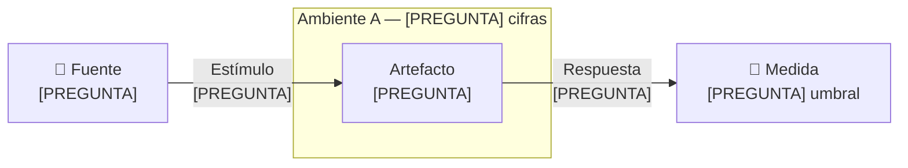

# Escenarios de calidad — [PREGUNTA] los atributos del reto

Alcance: [PREGUNTA] cuántos escenarios y de qué atributos, reescritos como
escenarios de seis partes en el espacio del problema.

{: .importante }
> Las ideas de solución quedan fuera de las seis partes. Un mecanismo concreto
> —un gestor de sesión, una cola, una réplica, una caché— es una hipótesis que
> las [decisiones de arquitectura](modelos/adrs.md) confirmarán o cambiarán. En
> la ficha no entra.

Esta es la primera página del recorrido que puede nombrar los identificadores de
escenario. Las cinco páginas de insumo no lo hacen, porque son la materia con la
que estos escenarios se construyen.

El vocabulario está fijado en el [glosario](glossary.md).

## 1. Los ASR

| ID | Atributo · rama | Enunciado corto | Amb. | Prioridad | Impacto | Origen |
|---|---|---|---|---|---|---|
| ASR-1 | [PREGUNTA] · detección | [PREGUNTA] qué se detecta o se logra, con su umbral y el símbolo ≤ | A | [PREGUNTA] | [PREGUNTA] | [PREGUNTA] matriz · R-n |

La rama dice qué parte del atributo cubre el escenario: **detección**,
**reacción**, **reparación** o **prevención**. Dos escenarios del mismo atributo
que cubren ramas distintas son escenarios distintos, y conviene que se vea en la
tabla.

## 1b. De qué historia cuelga cada escenario

Un escenario de calidad no vive solo: se ata a la historia de usuario cuyo actor
lo sufre o lo recibe. Esa historia aporta la fuente, el estímulo y la respuesta;
la ficha de abajo aporta el ambiente y la medida.

| ASR | Historia | Actor | Por qué esa y no otra |
|---|---|---|---|
| ASR-1 | [HU-01](requirements.md) — [PREGUNTA] | [PREGUNTA] | [PREGUNTA] qué tiene esa historia que las demás no |

[PREGUNTA] Párrafo que explique cuáles historias del árbol **no** cargan
escenario propio y por qué: casi siempre porque recorren el mismo camino que
otra que sí lo carga, y entonces la medida ya está fijada.

## 2. Ambientes

| Variable | A — normal | B — pico | C — degradado |
|---|---|---|---|
| Carga | [PREGUNTA] | [PREGUNTA] | [PREGUNTA] |
| Equivalente en TPS | [PREGUNTA] | [PREGUNTA] | [PREGUNTA] |
| Patrón de arribo | [PREGUNTA] | [PREGUNTA] | [PREGUNTA] |
| [PREGUNTA] variable del dominio | [PREGUNTA] | [PREGUNTA] | [PREGUNTA] |
| Alcance | [PREGUNTA] | [PREGUNTA] | [PREGUNTA] |

El **equivalente en TPS** no es opcional: Helix pide un número de transacciones
por segundo en cada ficha, y sin él el escenario queda incompleto en la réplica.

[PREGUNTA] Si dos escenarios se encadenan —uno detecta y el otro repara—,
declare aquí el **presupuesto conjunto**: la suma de sus umbrales y por qué cabe
en lo que el actor del negocio tolera.

### Supuestos que fijan las cifras

El enunciado no trae cifras de carga ni de tolerancia. Esta tabla las fija para
que los escenarios se puedan medir y para que las pruebas repliquen una
operación verosímil. Cada supuesto muestra de dónde sale, para que se pueda
corregir si el negocio da otro número.

La numeración continúa la de [restricciones](constraints.md).

| # | Supuesto | Cómo se obtiene |
|---|---|---|
| [PREGUNTA] | [PREGUNTA] | [PREGUNTA] |

## 2b. Matriz de análisis

[PREGUNTA] La matriz que corresponda a los atributos del reto. En el reto 2 fue
STRIDE, porque el tema era seguridad. Para disponibilidad sirve un recorrido de
modos de falla por componente; para desempeño, uno de recursos y cuellos de
botella; para modificabilidad, uno de puntos de cambio esperados.

Lo que no cambia es la regla: **se listan también las celdas descartadas, con su
razón**, para que la omisión sea una decisión y no un olvido.

| [PREGUNTA] eje de la matriz | Flujo o elemento del dominio | Stakeholder (aux.) | Modo | Amb. | Resultado |
|---|---|---|---|---|---|
| [PREGUNTA] | [PREGUNTA] | [PREGUNTA] | Detección | A | **ASR-1** |
| [PREGUNTA] | [PREGUNTA] | [PREGUNTA] | Reacción | A | Descartada: [PREGUNTA] la razón |

## 3. Fichas

Una ficha por ASR. Las seis partes son fuente, estímulo, artefacto, ambiente,
respuesta y medida; la séptima fila lleva prioridad, impacto y origen.

{: .nota }
> Helix no carga las seis partes: deriva `Source`, `Stimulus` y `Response` de la
> narrativa de la historia, y solo pide atributo, prioridad, artefacto,
> ambiente, TPS y medida, esta última con deslizadores fijos. Las medidas que no
> son de tiempo no tienen campo y viven solo en esta página. El detalle está en
> `notas/helix-recorrido-funcional.md`.

### ASR-1 — [PREGUNTA] título del escenario, descriptivo y sin mecanismo

| | |
|---|---|
| **Fuente** | [PREGUNTA] Quién o qué origina el estímulo |
| **Estímulo** | [PREGUNTA] Qué llega al sistema, y con qué patrón de arribo |
| **Artefacto** | [PREGUNTA] Qué parte del sistema recibe el estímulo |
| **Ambiente** | [PREGUNTA] Cuál de los tres ambientes, con sus cifras |
| **Respuesta** | [PREGUNTA] Qué hace el sistema, en términos observables |
| **Medida** | [PREGUNTA] El umbral con ≤, desde dónde y hasta dónde se mide, y en qué ambiente |
| **Prioridad · Impacto · Origen** | [PREGUNTA] · [PREGUNTA] · [PREGUNTA] |

#### Matriz de análisis del escenario

El recorte de la matriz general que explica por qué este escenario existe y qué
celda vecina quedó descartada.

| [PREGUNTA] eje | Flujo o elemento | Stakeholder (aux.) | Modo | Amb. | Resultado |
|---|---|---|---|---|---|
| [PREGUNTA] | [PREGUNTA] | [PREGUNTA] | [PREGUNTA] | A | **Este escenario** |

